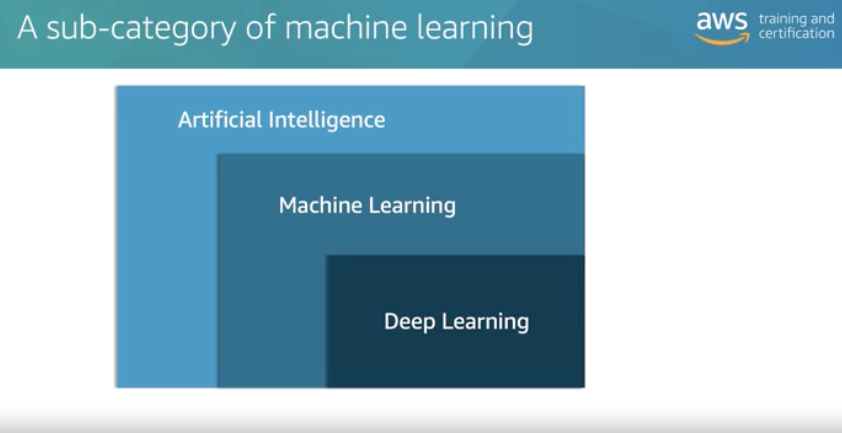
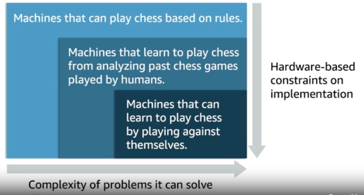
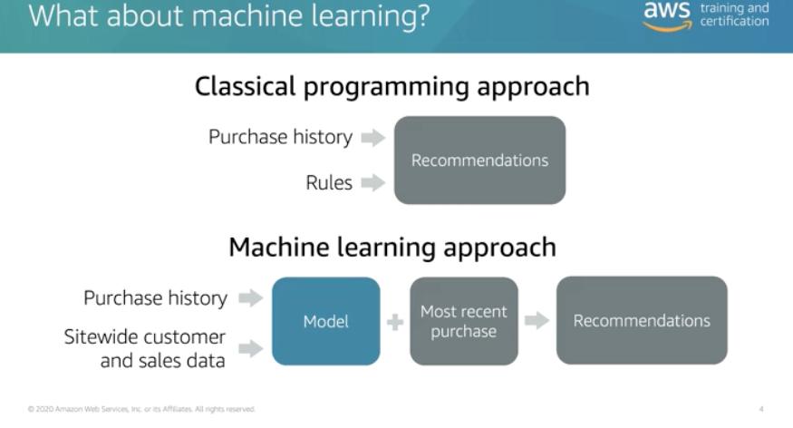
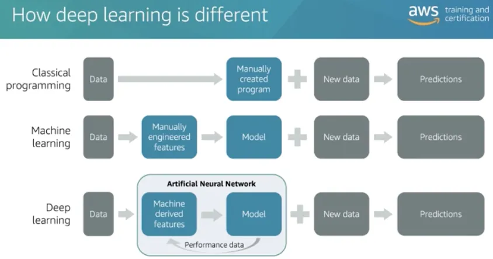
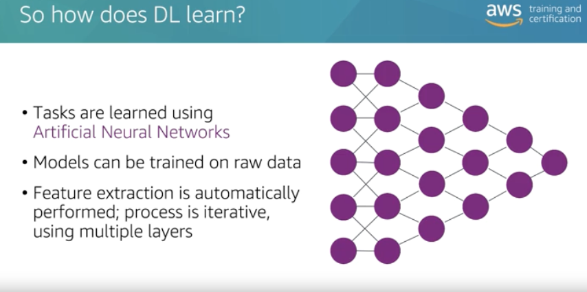
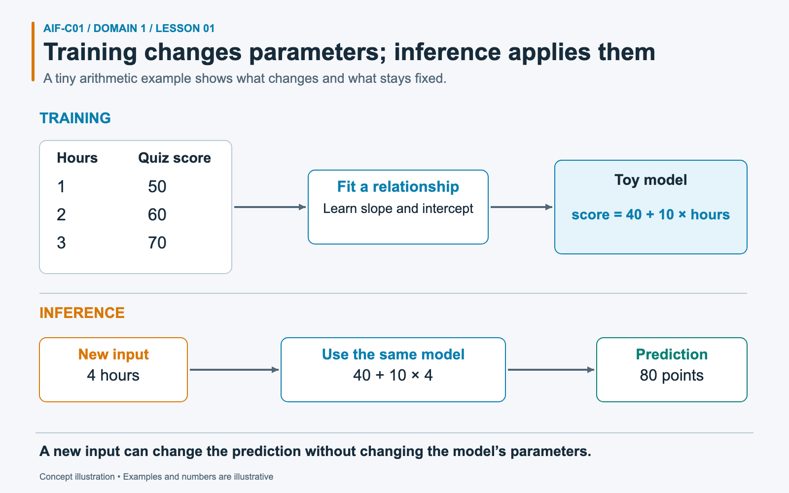
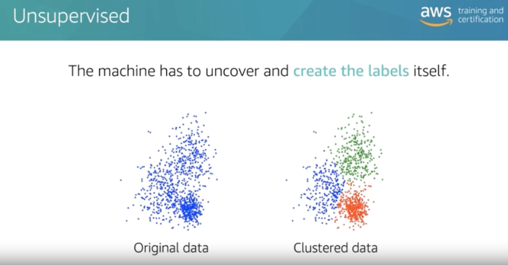
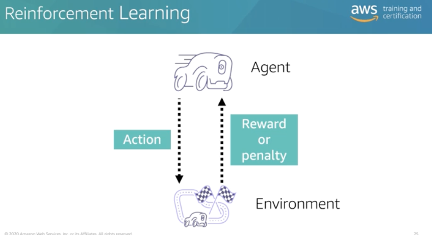
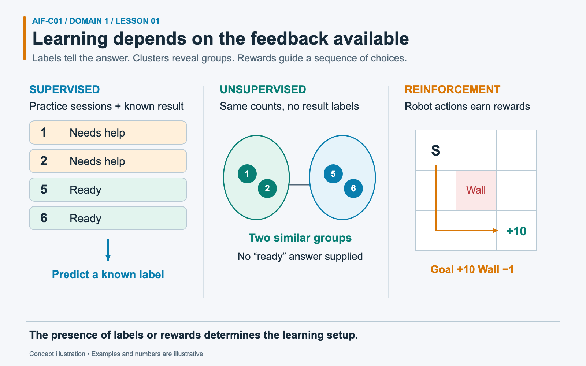

# Task 1.1: Explain basic AI concepts and terminologies

## Exam focus

Domain 1, Fundamentals of AI and ML, accounts for **20% of scored exam content**. Task 1.1 tests whether you can identify a concept from a short description and distinguish terms that sound alike. Expect prompts about learning types, data types, model fit, and inference choices.

This lesson covers every Task 1.1 objective in the [current AWS Domain 1 outline](https://docs.aws.amazon.com/aws-certification/latest/ai-practitioner-01/ai-practitioner-01-domain1.html).

## Mental model: rules, learning, generation, and action

Think of the field as nested layers:

1. **Artificial intelligence (AI)** is the broad field of building systems that perform tasks associated with human intelligence. A rules engine can count as AI even if it learns nothing.
2. **Machine learning (ML)** is a part of AI. An ML algorithm learns patterns from data instead of relying on a developer to encode every rule.
3. **Deep learning** is a part of ML that uses neural networks with many layers. It works well with large amounts of unstructured data such as images, speech, and text.
4. **Generative AI (GenAI)** uses models, often deep neural networks, to create new text, images, audio, video, or code.
5. **Agentic AI** combines a model with tools, memory, and an orchestration loop so the system can choose and perform steps toward a goal.

A chatbot that answers one question generates content. An agent that checks a calendar, proposes times, and books a meeting uses tools to act.

*2024 study notes, p. 12. Read the nesting from outside to inside: every deep learning system is ML, but not every ML system uses deep learning.*

*2024 study notes, p. 12. Chess makes the categories concrete, but self-play is not a definition of deep learning. Reinforcement learning can use a deep neural network or a different model.*

### Where the rules come from

*2024 study notes, p. 6. A programmed discount rule comes from a developer. A model predicting customer demand learns relationships from historical examples.*

*2024 study notes, p. 13. For image classification, a traditional ML workflow might use manually selected visual features; a deep network can learn useful representations during training. Both still need appropriate data and evaluation.*

## Core terms

| Term | Plain-language definition | Exam cue |
|---|---|---|
| Algorithm | A procedure used to learn a pattern or solve a problem | The training method or recipe |
| Model | The trained artifact that maps new inputs to outputs | The result of training |
| Training | Adjusting model parameters with data | Learns from historical examples |
| Inference | Using a trained model to produce an output for new input | Scores or generates after deployment |
| Neural network | Connected layers of weighted units that learn representations | Images, speech, deep learning |
| Computer vision | AI techniques that interpret images or video | Objects, faces, defects, scenes |
| Natural language processing (NLP) | AI techniques that process human language | Entities, sentiment, translation, text classification |
| Large language model (LLM) | A large model trained to process and generate language | Summarization, chat, text generation |
| Bias | A systematic skew in data, model behavior, or outcomes | One group receives worse results |
| Fairness | The goal of equitable treatment across relevant groups | Compare outcomes and error rates by group |
| Fit | How well a model learned useful patterns that generalize | Underfitting or overfitting |

*2024 study notes, p. 13. Inputs are measurements or representations of an example. Training adjusts connection weights so the network can combine them into a useful prediction.*

### Algorithm versus model

A team may use a gradient-boosting **algorithm** during training. Training produces a fitted **model**. The team deploys that model and sends it new records during inference.

### Training versus inference

Training consumes prepared data and compute to adjust parameters. Inference applies the finished model. Training may occur once a week, while an online application could run inference thousands of times per minute.

### Worked example: fitting a model and using it

*The numbers are an arithmetic illustration, not evidence that study time alone predicts examination performance.*

Suppose a tiny demonstration dataset contains **(1 hour, 50 points), (2 hours, 60 points), and (3 hours, 70 points)**. During training, a fitting procedure can find the relationship `score = 40 + 10 × hours`. The numbers **40** and **10** are parameters: values that determine the model’s behavior. Here, 10 describes the score increase per additional hour and 40 is the intercept, the formula’s value at zero hours.

Now a new input says **4 hours**. Inference applies the existing formula: `40 + 10 × 4 = 80`. The result is an **80-point prediction**, while the parameters remain unchanged. Adding another input does not itself train a new model. Updating the parameters using additional examples would be training again. This deliberately simple relationship illustrates the distinction; it does not demonstrate real-world predictive accuracy or causation.

### Underfitting and overfitting

- **Underfitting** means the model has not learned enough of the useful pattern. It performs poorly on both training data and unseen evaluation data.
- **Overfitting** means the model learned the training examples too closely, including noise. It performs well on training data but poorly on unseen data.
- **Good fit** means the model generalizes to relevant unseen data.

## Learning methods

| Learning method | Data and feedback | Typical result | Example |
|---|---|---|---|
| Supervised learning | Labeled examples contain the desired answer | Predict a known category or number | Classify email as spam; predict a home price |
| Unsupervised learning | Unlabeled examples contain no target answer | Discover structure or groups | Segment customers by behavior |
| Reinforcement learning | An agent receives rewards or penalties after actions | Learn a policy for sequential decisions | Choose robot movements through a warehouse |

**Classification** and **regression** are common supervised techniques. Classification predicts a class, such as fraud or legitimate. Regression predicts a continuous number, such as demand or price. **Clustering** is an unsupervised technique that finds groups without predefined labels.

*2024 study notes, p. 9. The groups are discovered from similarity. A cluster number is an identifier, not a verified target label; a person must interpret what each group means.*

*2024 study notes, p. 11. A warehouse robot tries a movement, observes the new situation, and receives feedback. Over repeated interactions it learns a policy for choosing actions.*

### Worked example: labels, groups, and rewards

*The same observations can support different learning setups depending on whether answers or action rewards are supplied.*

A workshop team records how many practice sessions four learners completed: **1, 2, 5, and 6**. For a supervised example, a teacher also labels the first two learners “Needs help” and the other two “Ready.” A **label** is the answer supplied with a training example. The model learns a relationship between session count and that known answer; four records illustrate the idea but do not establish a reliable readiness predictor.

Remove the labels and ask for similar groups. An unsupervised method can group **1 with 2** and **5 with 6**, but the numbers alone do not prove either group is ready. For reinforcement learning, the diagram changes to a robot: reaching its goal earns **+10**, while hitting a wall earns **−1**. Those rewards guide action choices. This differs from supplying a correct answer for every input.

## Data types use two separate axes

The first axis asks whether an answer accompanies each training example:

- **Labeled data** includes a target, such as an image paired with "damaged" or "not damaged."
- **Unlabeled data** has no target. A collection of transaction records without fraud decisions is unlabeled.

The second axis describes form:

- **Structured data** follows a schema. Tabular rows and columns are the common example.
- **Unstructured data** lacks a fixed row-and-column schema. Text, images, audio, and video fit here.
- **Time-series data** records observations over time, such as hourly electricity demand. It can be stored in a structured table.

These axes can overlap. A labeled image dataset is labeled and unstructured. A table of customer records without outcome labels is unlabeled and structured.

## Inference choices

| Inference mode | Select it when | Avoid it when |
|---|---|---|
| Batch | Inputs are ready together and users do not need an immediate response | A shopper waits for a checkout decision |
| Real-time | Each request needs a low-latency response | Work can wait and cost matters more than response time |
| Asynchronous | A request has a large payload or long processing time, and the caller can collect the result later | The caller needs an answer in the same interaction |
| Serverless | Traffic is intermittent or unpredictable and the team wants managed scaling without idle endpoint capacity | The workload needs predictable high throughput or serverless limits do not fit |

These terms describe different concerns. Batch, real-time, and asynchronous describe request timing. Serverless describes how AWS manages and bills the serving infrastructure. A serverless endpoint still answers inference requests.

For SageMaker AI deployment choices, AWS documents [real-time, serverless, asynchronous, and batch inference options](https://docs.aws.amazon.com/sagemaker/latest/dg/deploy-model-options.html).

## Scenario practice

### Scenario 1: overnight churn scores

A telecom company scores five million accounts each night. No customer waits for the result.

**Answer: batch inference.** The records are available together, and the output can arrive after processing. A real-time endpoint would pay for response capacity the business does not need.

### Scenario 2: unseen customer groups

A retailer has purchase histories but no segment labels. It wants the data to reveal groups with similar behavior.

**Answer: unsupervised learning with clustering.** Classification needs predefined categories in labeled training data. Clustering discovers the groups.

### Scenario 3: excellent training results, weak production results

An image model identifies nearly every training defect but misses many defects in new factory images.

**Answer: overfitting.** The gap between training and unseen-data performance shows poor generalization. Underfitting would cause weak performance on both sets.

### Scenario 4: long video processing

A media application submits a large video for analysis. Processing may take several minutes, and the application can notify the user when the result is ready.

**Answer: asynchronous inference.** The caller should not hold an interactive connection while the model handles a large, slow request.

### Scenario 5: meeting assistant

A system reads a request, checks three calendars through APIs, selects an available time, and sends invitations.

**Answer: agentic AI.** The system uses a model to plan and tools to act across several steps. Text generation alone would not make it agentic.

## Common confusions and traps

- Deep learning is a subset of ML. It is not a peer category beside ML.
- AI does not require learning. A hand-coded expert system can be AI without being ML.
- A model is the trained artifact; an algorithm is the procedure used to produce or run it.
- Inference means using a trained model. It does not mean retraining from live input.
- Labeled versus unlabeled describes whether targets exist. Structured versus unstructured describes format.
- Clustering finds unknown groups. Classification assigns known labels.
- Bias is a systematic skew. Fairness is an evaluation goal, not proof that a model has no errors.
- A generated response is GenAI. Tool use, memory, and multi-step action point to agentic AI.

## Compact decision table

| If the prompt says... | Choose... | Reason |
|---|---|---|
| "Predict a numeric value" | Regression | The target is continuous |
| "Assign one of known categories" | Classification | Labels exist before training |
| "Find natural groups" | Clustering | No target labels are required |
| "Learn through rewards" | Reinforcement learning | Actions receive delayed feedback |
| "Score a large stored dataset" | Batch inference | No interactive response is needed |
| "Respond during checkout" | Real-time inference | The user is waiting |
| "Queue a large, slow request" | Asynchronous inference | Work finishes outside the request cycle |
| "Spiky traffic, no server management" | Serverless inference | Managed capacity follows demand |

## Self-check

1. **Can an AI system exist without machine learning?**

   Yes. A rules-based expert system can implement AI behavior without learning from data.

2. **A model performs poorly on training and evaluation data. What is the likely fit problem?**

   Underfitting.

3. **Does a labeled text dataset count as structured data?**

   Not by default. It is labeled on the answer axis and unstructured on the format axis.

4. **Which learning method fits a robot that learns from rewards after each action?**

   Reinforcement learning.

5. **Which inference mode fits 200,000 mortgage risk scores that must finish before tomorrow morning?**

   Batch inference.

## Practice links

- [Domain 1 questions with answers and explanations](../../practice/question-bank.md#task-11)

## Official sources

- [AWS Certified AI Practitioner Domain 1 objectives](https://docs.aws.amazon.com/aws-certification/latest/ai-practitioner-01/ai-practitioner-01-domain1.html)
- [SageMaker AI inference options](https://docs.aws.amazon.com/sagemaker/latest/dg/deploy-model-options.html)
- [SageMaker AI asynchronous inference](https://docs.aws.amazon.com/sagemaker/latest/dg/async-inference.html)
- [AWS Machine Learning Lens: ML lifecycle](https://docs.aws.amazon.com/wellarchitected/latest/machine-learning-lens/machine-learning-lifecycle.html)

Source descriptions in this lesson were rephrased for compliance with licensing restrictions.

---

[Domain contents](README.md) · [All domains and objectives](../../README.md#domain-guide)

**Previous:** [Exam overview](../../exam-overview.md) · **Next:** [Lesson 02](02-ai-use-cases.md)
