# Task 1.2: Identify practical use cases for AI

## Exam focus

Domain 1 accounts for **20% of scored exam content**. Task 1.2 asks you to decide whether AI fits a problem, select a technique, match an application to an AWS service, and choose traditional ML or a foundation model.

This lesson covers every Task 1.2 objective in the [current AWS Domain 1 outline](https://docs.aws.amazon.com/aws-certification/latest/ai-practitioner-01/ai-practitioner-01-domain1.html).

## Mental model: predict, perceive, generate, or act

Start with the required outcome:

- **Predict** a category or number from known data: use traditional ML.
- **Perceive** language, speech, or images with a standard capability: use a managed AI service.
- **Generate** flexible text, images, audio, video, or code: use a foundation model.
- **Act** through APIs across several steps: use an agentic design.

Then test whether AI adds enough value to justify its cost and uncertainty.

## Where AI and ML add value

AI/ML fits tasks that depend on patterns rather than exact rules. It can provide **scalability** by processing more records, calls, or images than a human team can review. It can also provide **automation** for repetitive work such as routing tickets or transcribing calls.

Common value patterns include:

- assist a person by ranking cases, surfacing evidence, or estimating risk;
- process large workloads with consistent criteria;
- automate repetitive work such as routing tickets or transcribing calls;
- personalize recommendations for many users.

Human review remains valuable when an error can deny care, money, liberty, or access. In those cases, the model can provide decision support while an authorized person makes the decision.

## When AI is the wrong choice

Use normal software or a rules engine when:

- the business requires the same exact result from the same input;
- law or policy defines an explicit calculation;
- a short set of stable rules solves the problem;
- the available data is too sparse, irrelevant, or unrepresentative;
- expected savings or revenue do not cover development, inference, monitoring, and review costs.

A tax calculation is deterministic. A tax document classifier is predictive. The first belongs in tested code; the second may fit ML.

## Select the ML technique

| Required output | Technique | Learning type | Example |
|---|---|---|---|
| A continuous number | Regression | Supervised | Forecast next week's unit demand |
| A known category | Classification | Supervised | Mark a transaction as fraud or legitimate |
| Groups that are not defined in advance | Clustering | Unsupervised | Discover customer segments |

Forecasting often uses time-series methods. Fraud systems often use classification or anomaly detection. Read the requested output instead of choosing a technique from the industry alone.

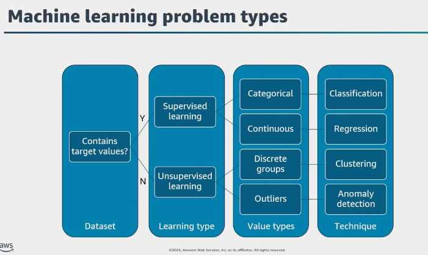

*Source: 2024 study notes, PDF p. 10. Start with the desired output and whether training examples have target answers. This is a simplified map: anomaly detection can also use supervised or semi-supervised methods when suitable labels are available.*

### Known categories versus numerical predictions

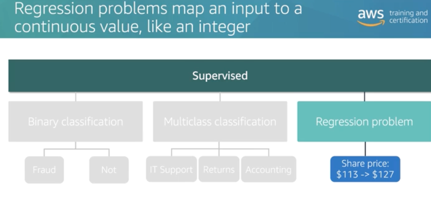

*Source: 2024 study notes, PDF p. 8. Binary classification chooses between two categories; multiclass classification chooses among more than two. Regression predicts a numerical quantity, which can include decimals—the original heading's integer example does not mean regression is limited to whole numbers.*

### Worked example: three event questions, three outputs

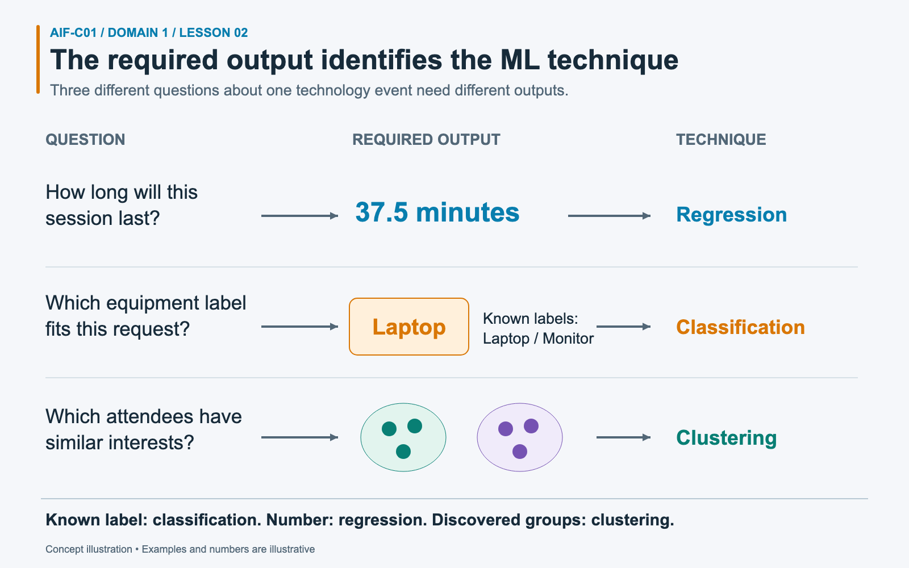

*The input’s subject is less decisive than whether the required answer is a number, a known label, or an unknown grouping.*

An event organizer has three questions. First, “How long will this session last?” Historical sessions include their measured durations. A model predicts **37.5 minutes** for the new session. That numerical estimate fits **regression**, which predicts a quantity rather than selecting a category.

Second, an equipment request must receive one of two existing labels: **Laptop** or **Monitor**. A model assigns **Laptop**. That is **classification**, because the possible categories were defined before the prediction. Third, the organizer wants to find attendees with similar interests without naming the groups in advance. **Clustering** discovers those groups from similarity in the input data.

All three problems concern the same event, but they need different outputs. A classifier could predict duration ranges only if the requirement changed to predefined categories such as “short” and “long.” It would then answer a different question from the precise duration estimate.

### Anomaly detection: unusual does not automatically mean wrong

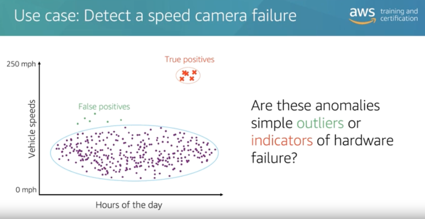

*Source: 2024 study notes, PDF p. 9. A camera suddenly reporting several cars at 240 mph should trigger investigation. An unusual reading could reflect a fault or a real event; the anomaly score alone does not establish the cause.*

### Optional algorithm examples: supervised prediction

The following historical diagrams connect problem types to examples of SageMaker algorithms. They provide additional context, not an algorithm list to memorize for this lesson. The foundational decision is still whether the application needs a category, a quantity, a grouping, or another output.

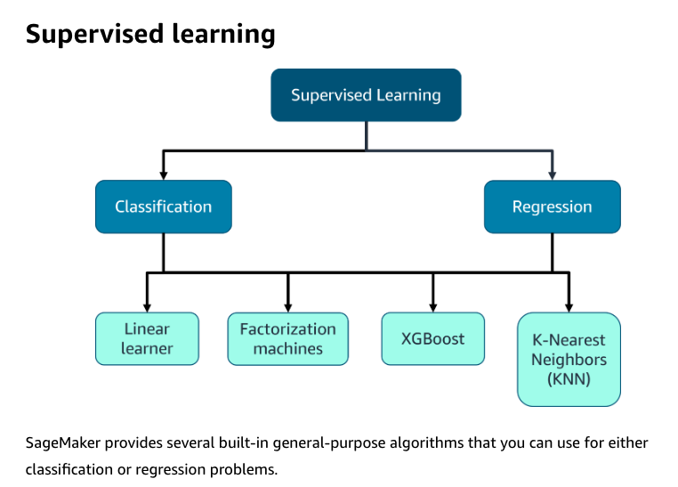

*Source: 2024 study notes, PDF p. 41. Different algorithms can solve the same type of problem. Predicting a house price and assigning a support-ticket category require different outputs even when an algorithm family supports both.*

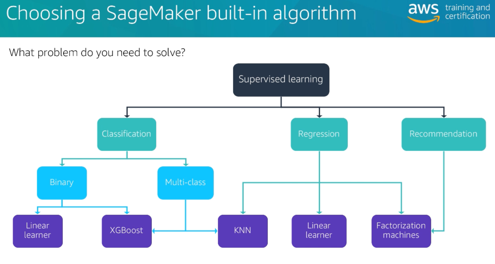

*Source: 2024 study notes, PDF p. 60. This historical map adds recommendation as another application, such as ranking products a customer might like. It illustrates possible choices rather than an exhaustive set of supported algorithms.*

### Optional algorithm examples: discovering patterns

Clustering groups similar records; topic modeling discovers recurring themes in documents; dimensionality reduction represents data using fewer features. For example, a team could discover themes in unlabeled event feedback before deciding which topics deserve follow-up.

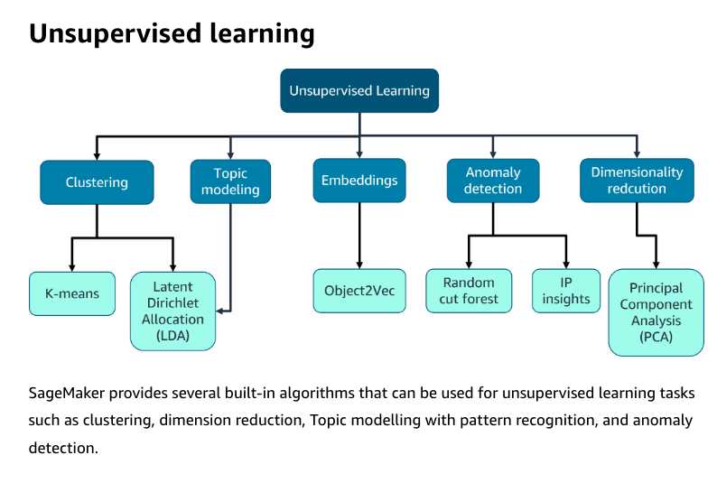

*Source: 2024 study notes, PDF p. 42. K-means illustrates clustering and PCA illustrates dimensionality reduction. Correction: the diagram groups Object2Vec too broadly under unsupervised learning; Object2Vec trains on pairs of inputs with relationship labels or similarity scores.*

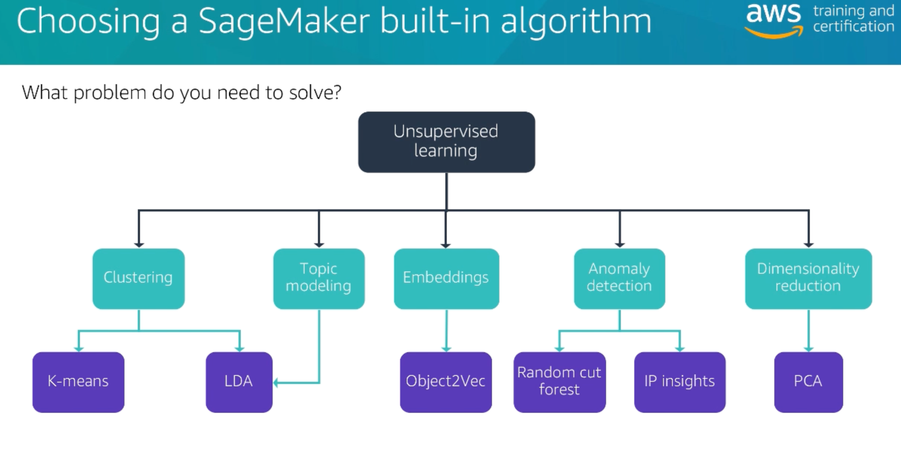

*Source: 2024 study notes, PDF p. 60. This alternate map repeats the same Object2Vec simplification. Learning embeddings does not by itself make a method unsupervised; the training data and learning objective determine that distinction. See the [AWS Object2Vec input requirements](https://docs.aws.amazon.com/sagemaker/latest/dg/object2vec.html).*

## Real-world application map

| Application | Input and outcome | Exam cue |
|---|---|---|
| Computer vision | Interpret images or video | Detect defects, objects, or unsafe conditions |
| NLP | Extract or classify meaning in text | Sentiment, entities, key phrases |
| Speech recognition | Convert spoken audio to text | Call transcript or captions |
| Recommendation system | Rank items for a user | "Customers may also like" |
| Fraud detection | Flag risky or unusual activity | Review suspicious transactions |
| Forecasting | Predict future values from history | Demand, sales, capacity |
| Knowledge base | Retrieve relevant organization information for a question | Answers grounded in internal documents |
| Agentic AI | Plan and use tools to complete a goal | Update, book, submit, or resolve |

### Text and speech: identify the transformation

Classifying a review, translating a sentence, and transcribing a recording are separate tasks. The next two historical diagrams show custom-model algorithm examples; the managed-service table below offers ready-made capabilities for many of these needs.

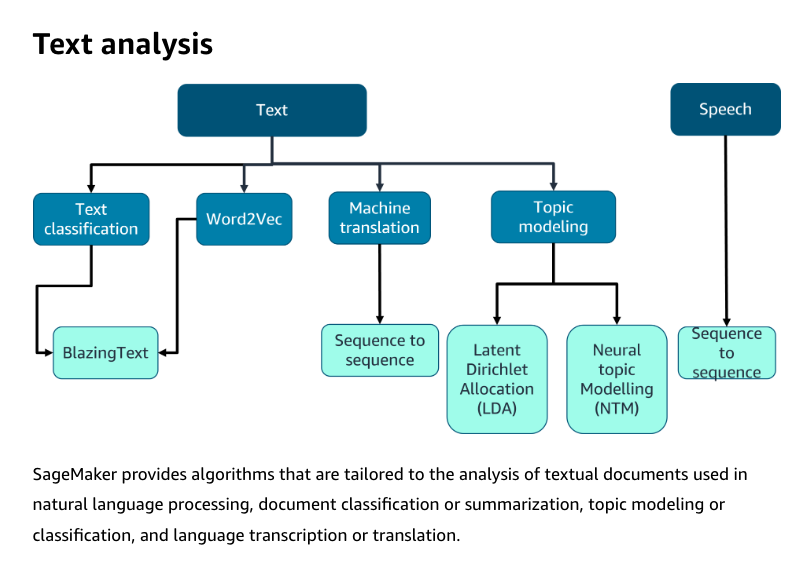

*Source: 2024 study notes, PDF p. 43. “What topic is this review about?” differs from “Translate this review into French.” Match the required transformation before selecting a model or service.*

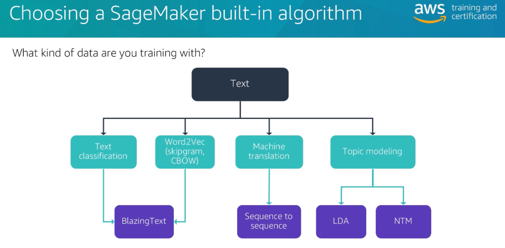

*Source: 2024 study notes, PDF p. 61. Word embeddings represent relationships between words; a classifier assigns labels; translation produces text in another language. The historical algorithm names are optional implementation context.*

### Images and time series: identify the output's shape

For a photo of a parking lot, **image classification** can answer “occupied,” **object detection** can locate each car with a bounding box, and **semantic segmentation** can label each pixel as road, car, or another category. **Time-series forecasting** instead predicts values along a timeline, such as parking demand tomorrow.

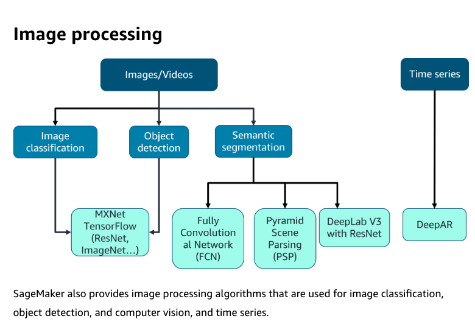

*Source: 2024 study notes, PDF p. 42. The useful distinction is the requested result: a label, object locations, pixel labels, or future values. Framework and architecture names reflect the original notes.*

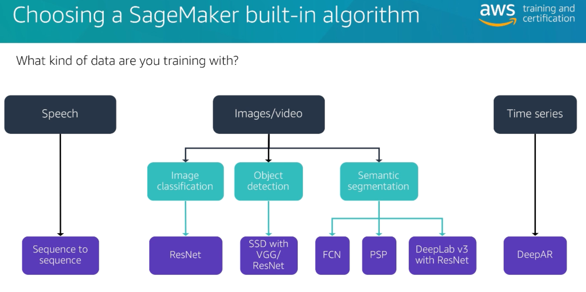

*Source: 2024 study notes, PDF p. 61. This alternate view compares data types and task-specific models. It is not a requirement to build these models; when a managed API already meets the need, the next section helps select it.*

## AWS managed AI and ML services

A managed AI service gives you a ready-made capability through an API. SageMaker AI gives you a platform to build, train, tune, and deploy models.

| Need | Select | Why |
|---|---|---|
| Build, train, tune, or host a custom ML model | Amazon SageMaker AI | You control data, algorithms, training jobs, and deployment |
| Convert speech to text | Amazon Transcribe | Automatic speech recognition for audio files or streams |
| Translate text between languages | Amazon Translate | Managed neural machine translation |
| Find sentiment, entities, key phrases, or language in text | Amazon Comprehend | Managed NLP analysis |
| Build a voice or text conversational interface around intents and slots | Amazon Lex V2 | Natural language understanding and speech recognition for bots |
| Convert text to spoken audio | Amazon Polly | Text-to-speech synthesis |

Related services may appear in scenarios. Amazon Rekognition analyzes images and video. Amazon Textract extracts printed text, handwriting, tables, and forms from documents. The six services in the table above are named in Task 1.2.

### Common service boundaries

- Transcribe is speech-to-text. Polly is text-to-speech.
- Translate changes language. Comprehend extracts meaning from text without translating it.
- Lex manages conversational intents and dialog. A broad, generative assistant usually points toward a foundation-model service instead.
- SageMaker AI is the custom ML platform. It is excessive when a ready-made API already matches the task.

### Worked example: a spoken comment becomes sentiment

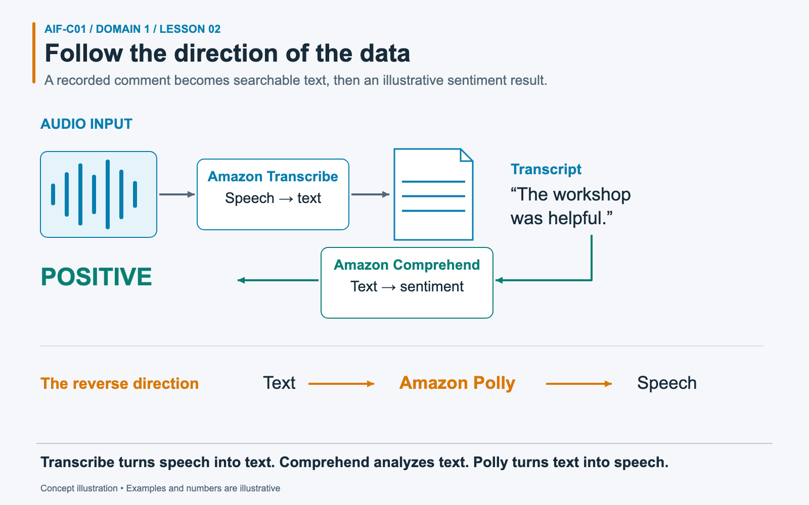

*Each service receives the kind of input it understands; the shown transcript and sentiment are illustrative outputs.*

A participant records the sentence **“The workshop was helpful.”** The organizer needs searchable words and an indication of sentiment. First, **Amazon Transcribe** converts the audio into a text transcript. A transcript is a written representation of speech. Second, the application sends that text to **Amazon Comprehend**, which can analyze sentiment: the attitude expressed in the text. The diagram shows an illustrative **POSITIVE** result.

The stages solve separate problems. Transcribing the recording makes the words available, but transcription alone does not perform the requested sentiment analysis. Comprehend receives text rather than the original audio. **Amazon Polly** goes in the opposite direction: it converts text into spoken audio, so it would fit a requirement to read the transcript aloud. A custom speech model could also be developed, but it adds model-development work when a managed capability already fits.

## Traditional ML or a foundation model

| Constraint or goal | Better starting point | Reason |
|---|---|---|
| Predict from tabular data with a fixed output schema | Traditional ML | Smaller models can be cheaper, faster, and easier to test |
| Explain a credit-risk score to an auditor | Traditional ML | Teams can select interpretable models and inspect features |
| Generate or summarize free-form language | Foundation model | The task requires flexible content generation |
| Handle many language tasks through prompts | Foundation model | One general model can support varied tasks |
| Strict latency and unit-cost limits | Traditional ML or a small FM | Match capacity to the narrow task |
| Multi-step work through tools | FM-based agent | The model can interpret intent and choose actions |

Regulation does not ban foundation models by itself. It raises the need for traceability, testing, privacy controls, and human oversight. If a simpler model meets the requirement with clearer explanations, the simpler model has the advantage.

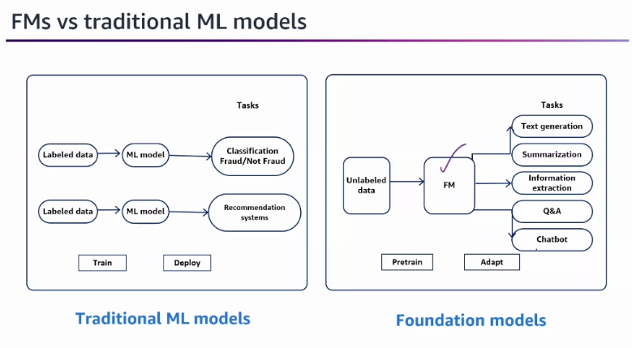

*Source: 2024 study notes, PDF p. 78. A narrow model may predict fraud, while one foundation model can support several language tasks. The data labels are simplified: traditional ML can also be unsupervised, and foundation-model adaptation can use labeled examples.*

## Scenario practice

### Scenario 1: call-center transcripts

A support team wants searchable text from recorded calls. It does not need summaries yet.

**Answer: Amazon Transcribe.** The direct requirement is speech-to-text. Polly reverses that direction, and Comprehend would analyze text after transcription.

### Scenario 2: sentiment from written reviews

A retailer needs positive, negative, neutral, or mixed sentiment from customer reviews.

**Answer: Amazon Comprehend.** Sentiment extraction is a managed NLP task. Translate would change the review's language but would not provide the requested sentiment result.

### Scenario 3: regulated loan score

A bank predicts default risk from a stable table of applicant features. Auditors need a clear account of the features that influenced each score.

**Answer: start with traditional ML in SageMaker AI.** The output is a narrow prediction from structured data, and explainability is central. A general foundation model adds cost and makes the decision path harder to audit.

### Scenario 4: policy-defined shipping fee

A company calculates a fee from package weight, destination zone, and a published rate table. The same inputs must produce the same fee.

**Answer: use deterministic application code.** The task follows exact rules. ML would add uncertainty without adding useful pattern recognition.

### Scenario 5: new customer segments

A marketing team wants to discover behavior groups and has no existing segment labels.

**Answer: clustering.** The team wants unknown groups from unlabeled data. Classification would require named classes and labeled examples.

### Scenario 6: account-resolution agent

A customer asks to update an address. The system verifies identity, retrieves the account, updates the record through an API, and confirms completion.

**Answer: agentic AI with guarded tool access.** The system must coordinate a sequence and take an action. A knowledge base could answer policy questions but cannot update the account by itself.

## Common confusions and traps

- Prediction is probabilistic. A scenario that demands an exact policy result points to code or rules.
- "Analyze text" is not enough to choose a service. Sentiment and entities point to Comprehend; translation points to Translate; speech input points first to Transcribe.
- A chatbot does not always require an LLM. Intent-based booking flows can fit Lex V2.
- A foundation model is not the default for every AI task. Narrow tabular predictions often fit traditional ML.
- A human reviewer does not make AI unnecessary. Decision support is a valid use case.
- Classification needs known labels. Clustering discovers groups without them.
- A knowledge base retrieves information. An agent uses tools to perform work.

## Compact decision table

| Scenario phrase | Best answer |
|---|---|
| "audio into a transcript" | Amazon Transcribe |
| "read this text aloud" | Amazon Polly |
| "French into English" | Amazon Translate |
| "sentiment and entities" | Amazon Comprehend |
| "intent-based voice bot" | Amazon Lex V2 |
| "custom training and endpoint" | Amazon SageMaker AI |
| "known classes" | Classification |
| "unknown groups" | Clustering |
| "continuous numeric result" | Regression |
| "guaranteed exact result" | Deterministic code or rules |

## Self-check

1. **Which service converts a written response into speech?**

   Amazon Polly.

2. **A team needs to assign support tickets to five known queues. Which technique fits?**

   Classification, using labeled examples for the five queues.

3. **A company wants one flexible system to draft, summarize, and rewrite text. Which model family is the better starting point?**

   A foundation model.

4. **Does a strict regulatory environment always rule out GenAI?**

   No. It adds compliance, evaluation, privacy, explainability, and oversight requirements. A simpler traditional model may still fit better.

5. **A hospital wants a model to rank scans for clinician review. Is this a valid AI use case?**

   Yes. The model assists human prioritization; the clinician retains the high-impact decision.

## Practice links

- [Domain 1 questions with answers and explanations](../../practice/question-bank.md#task-12)

## Official sources

- [AWS Certified AI Practitioner Domain 1 objectives](https://docs.aws.amazon.com/aws-certification/latest/ai-practitioner-01/ai-practitioner-01-domain1.html)
- [Amazon SageMaker AI documentation](https://docs.aws.amazon.com/sagemaker/latest/dg/whatis.html)
- [Amazon Transcribe documentation](https://docs.aws.amazon.com/transcribe/)
- [Amazon Translate: What is Amazon Translate?](https://docs.aws.amazon.com/translate/latest/dg/what-is.html)
- [Amazon Comprehend: What is Amazon Comprehend?](https://docs.aws.amazon.com/comprehend/latest/dg/what-is.html)
- [Amazon Lex V2: What is Amazon Lex V2?](https://docs.aws.amazon.com/lexv2/latest/dg/what-is.html)
- [Amazon Polly documentation](https://docs.aws.amazon.com/polly/)

Source descriptions in this lesson were rephrased for compliance with licensing restrictions.

---

[Domain contents](README.md) · [All domains and objectives](../../README.md#domain-guide)

**Previous:** [Lesson 01](01-ai-ml-concepts.md) · **Next:** [Lesson 03](03-lifecycle-mlops-metrics.md)
