# Task 1.3: Describe the AI/ML development lifecycle

## Exam focus

Domain 1 accounts for **20% of scored exam content**. Task 1.3 tests the order and purpose of pipeline stages, ways to source and host models, AWS service roles, MLOps practices, and the difference between model and business metrics.

This lesson covers every Task 1.3 objective in the [current AWS Domain 1 outline](https://docs.aws.amazon.com/aws-certification/latest/ai-practitioner-01/ai-practitioner-01-domain1.html).

## Mental model: a loop with evidence at every handoff

An ML system is not finished when training ends. Teams collect data, prepare it, train and evaluate a model, deploy it, monitor live behavior, and feed new evidence into the next cycle.

A useful sequence is:

**business goal → data collection and labeling → preparation and features → training → evaluation and tuning → deployment → monitoring → retraining**

A team should define business success before choosing a model metric. A classifier can score well in a notebook and still fail if it costs too much, responds too slowly, or frustrates customers.

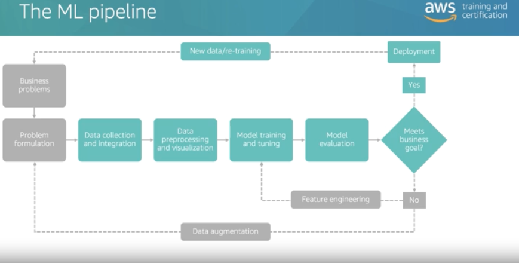

*2024 study notes, p. 15. Follow the model from a business need through data, training, evaluation, and production. Monitoring supplies evidence for the next iteration.*

## Pipeline components

| Stage | Team activity | Typical AWS fit |
|---|---|---|
| Frame the problem | Define users, outcome, constraints, baseline, and success metrics | Architecture and governance work |
| Collect and store data | Gather representative, permitted data | Amazon S3 and governed data stores |
| Prepare data | Clean, transform, label, split, and create features | SageMaker AI processing capabilities |
| Train | Fit model parameters to training data | SageMaker AI training; FM providers pre-train base models |
| Evaluate and tune | Test on held-out data and compare candidates | SageMaker AI evaluation and experiments; Bedrock evaluations for GenAI resources |
| Deploy | Expose a model for batch or online inference | SageMaker AI endpoints and batch jobs; Bedrock managed model APIs |
| Monitor | Track latency, errors, cost, data quality, drift, and outcome quality | Amazon CloudWatch and SageMaker monitoring capabilities |
| Retrain and release | Use newer data, reevaluate, approve, and redeploy | Repeatable SageMaker AI pipelines and model registry workflows |

Data splitting prevents a model from grading itself on examples it memorized. A common split uses training data to fit parameters, validation data to tune choices, and test data for a final unbiased estimate.

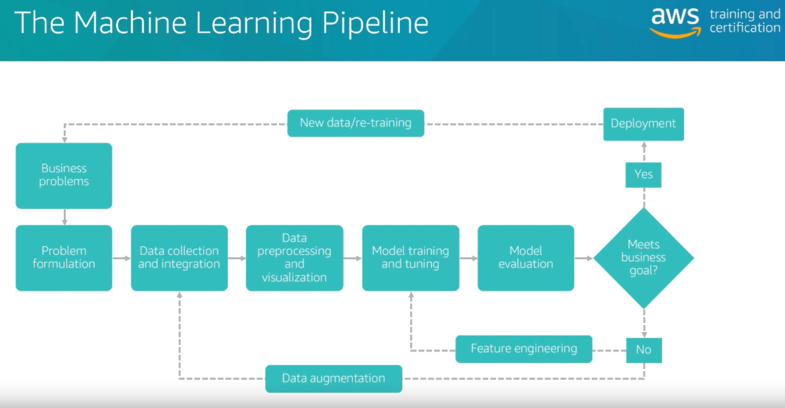

*2024 study notes, p. 57. This expands the overview above. Each handoff needs a usable output: prepared data for training, an evaluated model for deployment, and production evidence for monitoring.*

### Prepared features and training records

A **feature** is an input used by a model. A café demand model might use day of the week, weather, and recent sales. Reusing the same feature definitions during training and inference helps avoid inconsistent inputs.

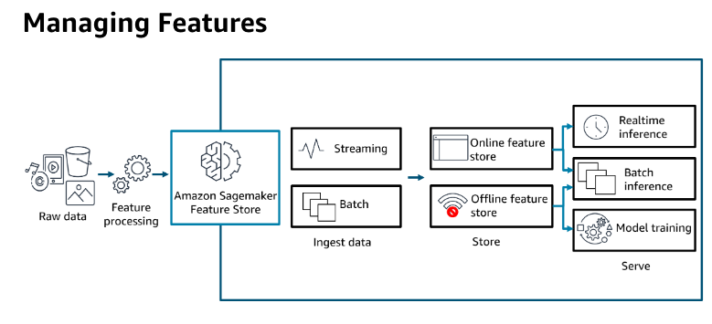

*2024 study notes, p. 38. An online store supports fast lookups of current feature values; an offline store supports historical datasets. The store organizes features; it does not train the prediction model.*

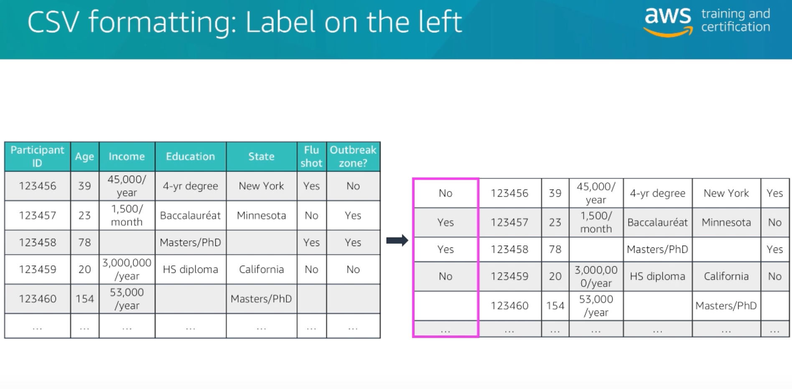

*2024 study notes, p. 62. This is one algorithm's input convention, not a universal CSV rule. For a demand example, cups sold could be the target and weather could be a feature. Always follow the chosen algorithm's expected format.*

### Worked example: releasing a ticket-routing model

*This split and the 90% acceptance target belong to the illustrative project; neither is a universal recommendation.*

A support team wants to route incoming tickets and defines a **90% final-test accuracy target** for this simplified example. It collects **1,000 labeled tickets** and separates them into **700 training**, **150 validation**, and **150 test** records. The training set fits model parameters. The validation set helps compare models or settings. The test set stays separate until the final performance check, reducing the chance of reporting success on examples that influenced model selection.

The chosen model correctly routes **140 of 150 test tickets**, or about **93.3%**, meeting this project’s stated target. After review, the team deploys that version and monitors actual outcomes. New ticket patterns can trigger investigation and another evaluated version; live feedback does not automatically rewrite the released model. Reusing the same records for training and final testing would provide weaker evidence because the model may have memorized them.

### A project includes more than training

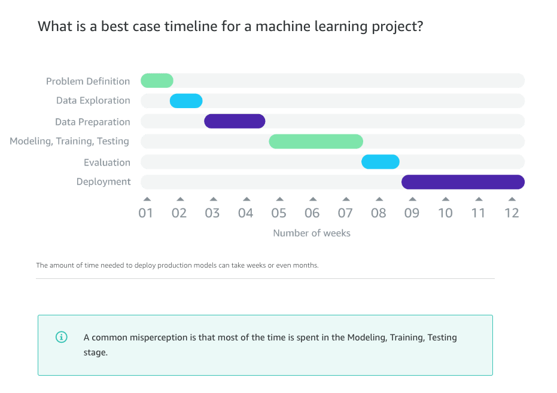

*2024 study notes, p. 32. The durations are an example, not a required project length or a study schedule. The useful lesson is that data preparation, evaluation, and deployment take work alongside training.*

## Sources of foundation models

| Source | Control | Cost and effort | Best fit |
|---|---|---|---|
| Managed provider model | Lower infrastructure control | Fast start; usage-based inference | Teams that want a capable FM through Amazon Bedrock |
| Open-source pretrained model | More model and hosting control | Team manages licenses, tuning, security, and serving | A required architecture, license, or customization path |
| Custom model trained from scratch | Highest control | Largest data, compute, expertise, and time burden | A justified need that available models cannot meet |

A pretrained model has already learned broad patterns. Fine-tuning adapts its weights with task or domain examples. Training from scratch begins without those pretrained weights and demands much more data and compute.

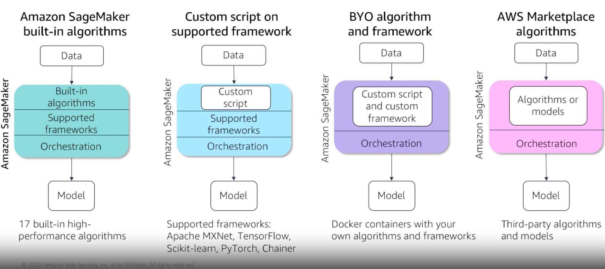

*2024 study notes, p. 59. These are implementation choices for a broader ML workflow. A container packages software; it is not itself a foundation model. Framework names and supported versions in this historical figure need checking before use.*

## Production access: managed API or self-hosted API

| Choice | Team owns | Tradeoff |
|---|---|---|
| Managed API | Application integration, prompts or inputs, evaluation, access control, and usage management | Fast delivery and low infrastructure work, with less hosting control |
| Self-hosted API | Compute, scaling, patching, model server, availability, observability, and security | More control, with more operating burden |

Amazon Bedrock provides managed access to foundation models. SageMaker AI can train and host models on managed AWS infrastructure while letting the team choose instances, containers, scaling, and endpoint configuration. That gives more control than a serverless FM API without forcing the team to run raw servers.

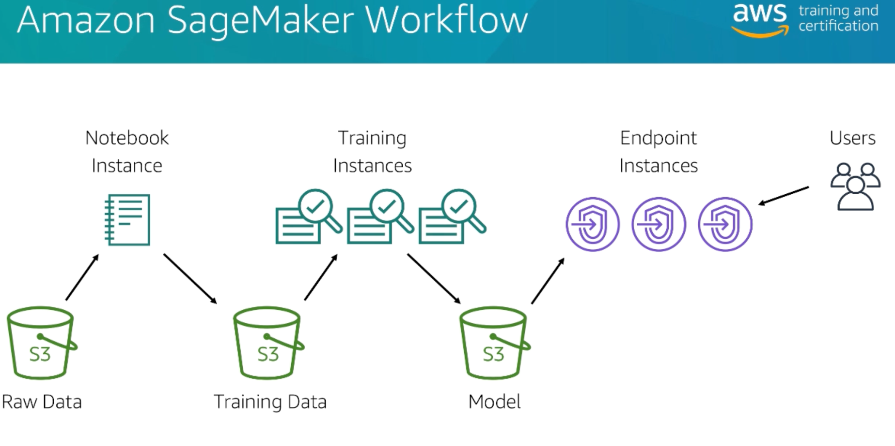

*2024 study notes, p. 57. A notebook is where someone develops an experiment. A training job learns model parameters, and an endpoint serves predictions. Creating a notebook alone does not deploy a model.*

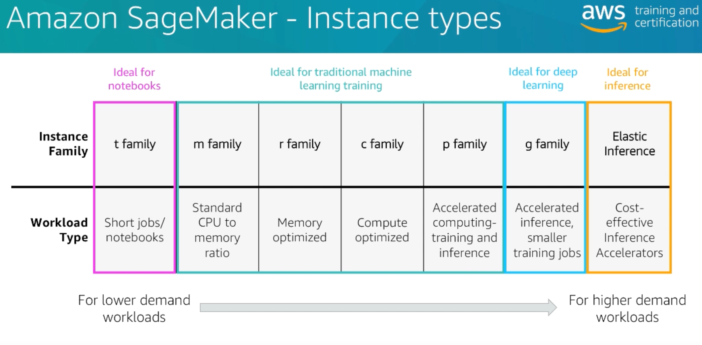

*2024 study notes, p. 59. Historical infrastructure example: Elastic Inference is no longer available. Use the picture to distinguish compute choices from the model itself; the instance names are not a current deployment recommendation. [AWS availability notice](https://docs.aws.amazon.com/AmazonECS/latest/developerguide/task_definition_parameters_ec2.html).*

## Service selection across the lifecycle

- **Amazon SageMaker AI** supports data preparation, model building, training, tuning, deployment, and MLOps workflows. Choose it when the team owns the ML model-development process.
- **Amazon Bedrock** provides managed access to foundation models and GenAI building blocks. Choose it when an application needs FM inference, knowledge retrieval, safeguards, or agent capabilities without managing model infrastructure.
- **Amazon Quick** is an AI-powered workspace for business users to analyze data, research, build applications, use agents, and automate work through natural-language interaction. It is an end-user work service, not the place to train an ML model.
- **Kiro** is an AI coding agent available through an agentic desktop development environment, a CLI, and other surfaces. It supports spec-driven development, built-in and custom agents, steering, and event-driven hooks; it is not a model-training platform.

### A training request starts a separate job

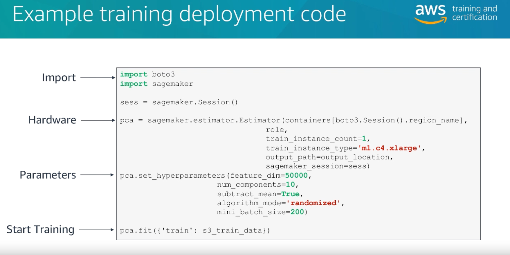

*2024 study notes, p. 62. Read this as a workflow illustration: code supplies the training configuration and data location, then starts managed work. It is not a current copy-and-run example, and writing SDK code is beyond this foundational lesson's purpose.*

## MLOps concepts

**Machine learning operations (MLOps)** applies engineering and operating practices to the ML lifecycle.

- **Experimentation:** record code, data versions, parameters, metrics, and artifacts so teams can compare runs.
- **Repeatable processes:** automate preparation, training, tests, approval, and deployment. A rerun should not depend on undocumented notebook steps.
- **Scalable systems:** support larger data, more traffic, and more models without rebuilding the workflow.
- **Technical debt management:** track brittle data dependencies, duplicated features, stale models, and manual release steps that raise future cost.
- **Production readiness:** add security, reliability, rollback, observability, capacity planning, and ownership before release.
- **Model monitoring:** watch model quality, input drift, bias, errors, latency, and business outcomes after deployment.
- **Retraining:** train a new version when data or business conditions change. Evaluate and approve that version before replacing production.

**Data drift** means the distribution of live inputs has changed. **Concept drift** means the relationship between inputs and the correct outcome has changed. Monitoring can detect symptoms; retraining is one possible response after the team finds the cause.

AWS describes SageMaker AI Pipelines as connected steps that can cover preprocessing, training, evaluation, and deployment. See [SageMaker AI Pipelines](https://docs.aws.amazon.com/sagemaker/latest/dg/pipelines-overview.html).

SageMaker Model Monitor can capture inference inputs and outputs, compare tabular statistics or model-quality metrics with baselines, run scheduled monitoring, report constraint violations, and publish metrics to CloudWatch. It supports eligible existing customers, but AWS closed Model Monitor to new customers on July 30, 2026 and does not plan new features. New customers should use current SageMaker and CloudWatch observability options that fit the workload.

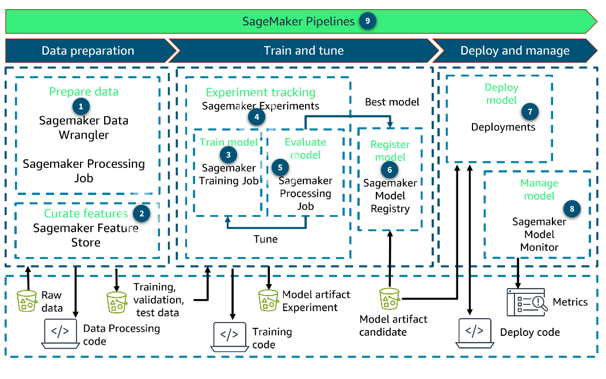

*2024 study notes, p. 54. Follow how a model moves through the system and how monitoring closes the loop. Model Monitor is now in maintenance; this figure illustrates the operating pattern rather than a setup available unchanged to every new customer. [AWS maintenance guidance](https://docs.aws.amazon.com/general/latest/gr/maintenance_services.html).*

## Classification metrics

Start with four counts:

- **True positive (TP):** predicted positive, and the case is positive.
- **False positive (FP):** predicted positive, but the case is negative.
- **True negative (TN):** predicted negative, and the case is negative.
- **False negative (FN):** predicted negative, but the case is positive.

| Metric | Formula | Use it when |
|---|---|---|
| Accuracy | `(TP + TN) / all predictions` | Classes are balanced and error costs are similar |
| Precision | `TP / (TP + FP)` | False alarms are costly |
| Recall | `TP / (TP + FN)` | Missing a positive case is costly |
| F1 score | Harmonic mean of precision and recall | Both false positives and false negatives matter |

A fraud dataset may contain 99.5% legitimate transactions. A model that labels everything legitimate gets 99.5% accuracy and zero fraud recall. Class imbalance makes accuracy a poor headline metric in that case.

### Worked example: which mistakes does a fraud detector make?

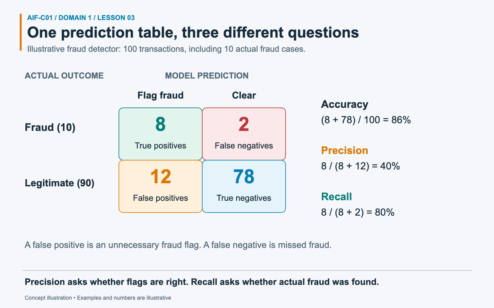

*The denominators explain the difference: all transactions for accuracy, all fraud flags for precision, and all actual fraud for recall.*

A detector reviews **100 transactions**. Ten are actually fraudulent. It flags **8** of those and misses **2**. Of the **90** legitimate transactions, it wrongly flags **12** and correctly clears **78**. A **confusion matrix** organizes these counts by actual outcome and prediction. A false positive is an incorrect fraud flag; a false negative is fraud that was missed.

Accuracy counts every correct decision: `(8 + 78) / 100 = 86%`. Precision asks how trustworthy the fraud flags are: `8 / (8 + 12) = 40%`. Recall asks how much actual fraud the detector finds: `8 / (8 + 2) = 80%`. The same system therefore has three different scores without contradiction. Improving the number of detected fraud cases alone may also increase false alarms. The relevant tradeoff depends on the cost of missed fraud and unnecessary investigation.

### Thresholds and ROC-AUC

Many binary classifiers produce a score. A **threshold** turns that score into a decision. Lowering a fraud-alert threshold generally catches more fraud while also flagging more legitimate transactions. Raising it generally reduces both kinds of flags.

A **ROC curve** shows true-positive rate (recall) against false-positive rate as that threshold varies. **AUC** summarizes how well the model ranks positive examples above negative ones: 1 is perfect ranking, 0.5 is random ranking, and values below 0.5 are possible. AUC is not the percentage of correct predictions at a selected threshold.

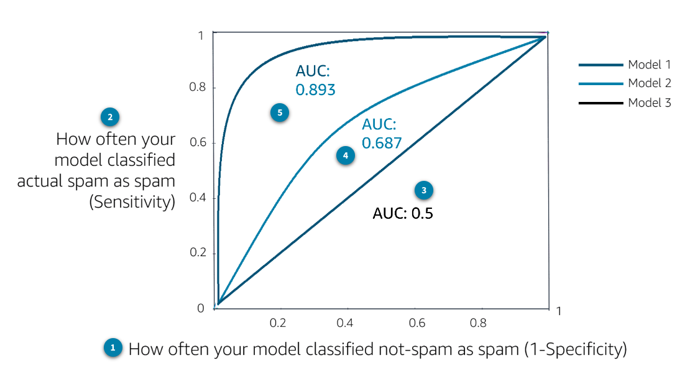

*2024 study notes, p. 46. In this example, the curve nearer the upper-left corner separates the classes better. The diagonal is the random-ranking baseline. [AWS explanation of AUC and decision thresholds](https://docs.aws.amazon.com/machine-learning/latest/dg/binary-model-insights.html).*

**Correction to the original figure below:** its horizontal-axis label equates false-positive rate with specificity. The correct relationship is **false-positive rate = 1 − specificity**. Specificity is `TN / (TN + FP)`; false-positive rate is `FP / (TN + FP)`.

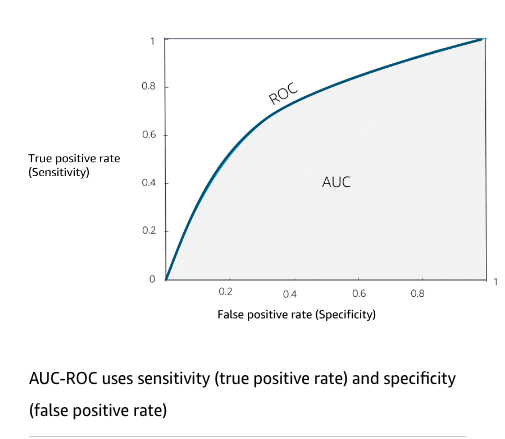

*2024 study notes, p. 46, preserved original. Use the corrected relationship above when interpreting this diagram. The preceding ROC comparison uses the correct horizontal-axis wording.*

## Business metrics

- **Cost per user or prediction** measures ongoing operating cost at expected scale.
- **Development cost** includes data work, engineering, review, security, and model development.
- **Customer feedback** captures usefulness, trust, and failure patterns that offline model scores miss.
- **Return on investment (ROI)** compares attributable financial benefit with total build and operating cost over a stated period. A common form is `(attributable benefit - total investment cost) / total investment cost`; define the baseline and attribution method.

Model metrics show task performance. Business metrics show whether the system creates enough value. Teams need both.

## Scenario practice

### Scenario 1: rare disease screening

A screening model should miss as few true cases as possible, even if clinicians review more false alarms.

**Answer: prioritize recall.** False negatives carry the larger cost. Precision still matters for workload, but recall matches the stated priority.

### Scenario 2: promotional email filter

A filter should avoid hiding legitimate customer email. The team accepts that some promotions will remain in the inbox.

**Answer: prioritize precision for the "promotion" class.** A false positive hides legitimate mail. High precision means most messages flagged as promotions are promotions.

### Scenario 3: stale production model

A demand model was accurate last year. Customer behavior changed, and live error rates have risen.

**Answer: monitor, diagnose drift, retrain with relevant newer data, reevaluate, then redeploy.** Deploying an untested retrained model skips the approval evidence needed for production.

### Scenario 4: fastest FM launch

A small team wants to add summarization without selecting GPU instances or running model servers.

**Answer: use a managed FM API through Amazon Bedrock.** Self-hosting adds capacity, patching, and availability work that the requirement rejects.

### Scenario 5: repeatable model releases

A team trains models through manually edited notebooks and cannot reproduce last month's production artifact.

**Answer: add MLOps versioning and an automated pipeline.** Record data, code, parameters, and artifacts, then automate tests and promotion.

## Common confusions and traps

- The lifecycle is iterative. Monitoring feeds evaluation, retraining, and another controlled release.
- Retraining does not mean automatic deployment. A new model still needs evaluation and approval.
- Accuracy can hide failure on a rare positive class.
- Precision answers, "Of the cases flagged, how many were correct?" Recall answers, "Of all real positive cases, how many did we catch?"
- Fine-tuning a pretrained model is not training from scratch.
- Managed APIs reduce infrastructure work. They do not remove the customer's duties for access control, evaluation, monitoring, and appropriate use.
- Amazon Quick and Kiro help different users perform work. SageMaker AI and Bedrock are model and application platforms.

## Compact decision table

| Need | Select |
|---|---|
| Full custom ML lifecycle | Amazon SageMaker AI |
| Managed foundation-model access | Amazon Bedrock |
| Business analysis and task automation through natural language | Amazon Quick |
| Agentic software-development environment | Kiro |
| Reproduce training runs | Experiment tracking plus versioned data, code, and parameters |
| Catch as many true positives as possible | Recall |
| Reduce false alarms | Precision |
| Balance precision and recall | F1 score |
| Judge economic success | ROI and cost metrics |

## Self-check

1. **Which stage follows training before production deployment?**

   Evaluation and tuning on data that training did not use.

2. **A classifier has high accuracy but catches no rare fraud cases. Which metric exposes the failure?**

   Recall for the fraud class.

3. **Does a managed model API remove the need for monitoring?**

   No. The provider manages serving infrastructure, while the application owner still monitors quality, cost, security, and outcomes.

4. **What makes an ML process repeatable?**

   Versioned inputs and artifacts, recorded experiments, automated steps, and defined approval criteria.

5. **Which metric answers whether the application earned more value than it cost?**

   ROI.

## Practice links

- [Domain 1 questions with answers and explanations](../../practice/question-bank.md#task-13)

## Official sources

- [AWS Certified AI Practitioner Domain 1 objectives](https://docs.aws.amazon.com/aws-certification/latest/ai-practitioner-01/ai-practitioner-01-domain1.html)
- [AWS Machine Learning Lens: ML lifecycle](https://docs.aws.amazon.com/wellarchitected/latest/machine-learning-lens/machine-learning-lifecycle.html)
- [SageMaker AI Pipelines overview](https://docs.aws.amazon.com/sagemaker/latest/dg/pipelines-overview.html)
- [SageMaker AI experiments for MLOps](https://docs.aws.amazon.com/sagemaker/latest/dg/experiments-mlops.html)
- [SageMaker AI model quality metrics](https://docs.aws.amazon.com/sagemaker/latest/dg/model-monitor-model-quality-metrics.html)
- [SageMaker Model Monitor availability change](https://docs.aws.amazon.com/sagemaker/latest/dg/model-monitor-availability-change.html)
- [Amazon Bedrock evaluations](https://docs.aws.amazon.com/bedrock/latest/userguide/evaluation.html)
- [Amazon Quick documentation](https://docs.aws.amazon.com/quicksuite/latest/userguide/)
- [Kiro documentation](https://kiro.dev/docs/)
- [How Kiro works](https://kiro.dev/docs/how-kiro-works.md)

Source descriptions in this lesson were rephrased for compliance with licensing restrictions.

---

[Domain contents](README.md) · [All domains and objectives](../../README.md#domain-guide)

**Previous:** [Lesson 02](02-ai-use-cases.md) · **Next:** [Lesson 04](../domain-2-generative-ai/04-genai-concepts-agents.md)
