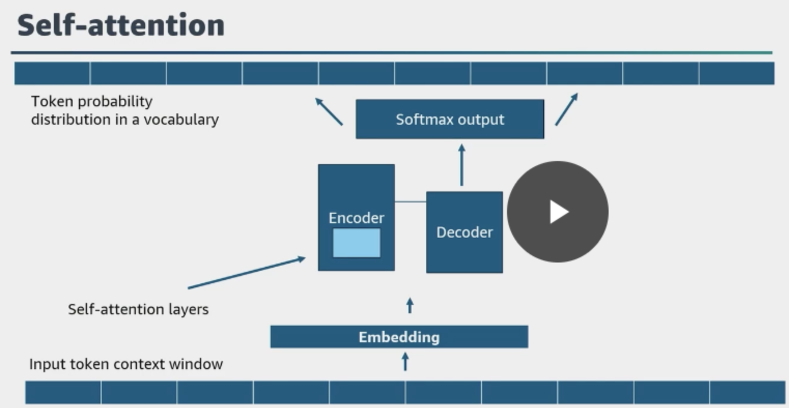
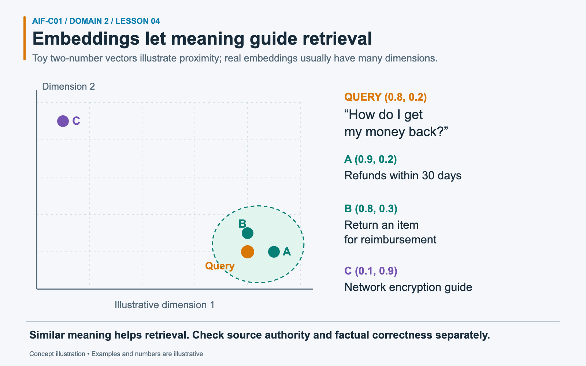
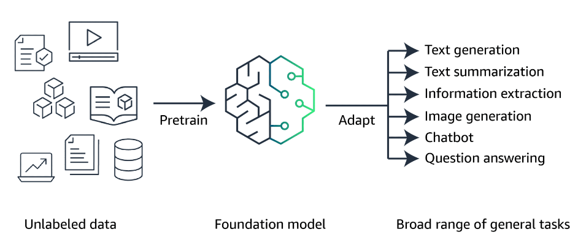

# Task 2.1: Explain the basic concepts of generative AI

## Exam focus

Domain 2, Fundamentals of GenAI, accounts for **24% of scored exam content**. Task 2.1 tests GenAI vocabulary, use cases, the foundation-model lifecycle, token economics, context engineering, and the parts of an agentic system.

This lesson covers every Task 2.1 objective in the [current AWS Domain 2 outline](https://docs.aws.amazon.com/aws-certification/latest/ai-practitioner-01/ai-practitioner-01-domain2.html).

## Mental model: represent, retrieve, generate, and act

A GenAI application moves through four ideas:

1. It represents input as **tokens** and numeric **vectors**.
2. It can retrieve relevant context by comparing **embeddings**.
3. A **foundation model** generates an output from instructions and context.
4. An **agent** can choose tools and coordinate steps beyond a single response.

The model is one component. The application decides which context, tools, safety checks, and memory the model receives.

## Foundation concepts

| Term | Definition | Distinguishing point |
|---|---|---|
| Foundation model (FM) | A broadly pretrained model that can support many downstream tasks | The base model may handle text, images, audio, or several modalities |
| Large language model (LLM) | A foundation model focused on understanding and generating language | LLM describes language capability, not every FM |
| Transformer | A neural-network architecture that uses attention to model relationships among tokens | It underpins many modern LLMs |
| Token | A unit a model reads or generates, such as a word fragment, word, or punctuation mark | Context limits and text-inference charges use token counts |
| Prompt engineering | Designing instructions and examples to guide a model response | Focuses on the request sent to the model |
| Context engineering | Selecting, assembling, ordering, and maintaining all information available to the model | Includes prompts, history, retrieved data, tool results, and memory |
| Multimodal model | A model that accepts or produces more than one data type | A prompt can include text and an image |
| Diffusion model | A generative model that learns to create data through a noise-removal process | Common in image generation |

### How a transformer generates text

Read the diagram from bottom to top: input tokens become numeric representations, attention helps the model use relationships among tokens, and the output is a probability distribution over possible next tokens. For a prompt such as “The café serves,” the model might assign different probabilities to continuations such as “coffee” and “breakfast.” A decoding method selects the next token, adds it to the sequence, and repeats. Sampling does not always select the highest-probability token, and ordinary inference does not change the model's learned weights.

*Source: 2024 personal study notes, PDF p. 76. This is a simplified encoder–decoder example; many text-generating LLMs use a decoder-only architecture. The play icon is part of the original static screenshot. The input strip is only part of the context budget described below.*

### Tokens and context windows

A **context window** is the maximum token capacity a model can process in a request, covering input and output under the model's rules. Input may include system instructions, conversation history, retrieved passages, tool descriptions, and the user's message.

Longer context can raise cost and latency. It can also dilute relevant evidence. Send the smallest set of trustworthy context that supports the task, and reserve enough output tokens for the answer.

### Worked example: allocating a context window

*This is a hypothetical combined capacity limit. Output capacity is not a claim that unused tokens are billed as generated output.*

Assume a hypothetical model allows **1,000 tokens** for combined input and output. A **token** is a unit a model processes, often a word fragment, word, or punctuation mark. The request contains **100 instruction tokens**, **50 question tokens**, **250 history tokens**, and **400 source-passage tokens**. Those inputs total **800**, leaving **200 tokens of capacity** for the response under this example’s rules.

The application finds that **150 history tokens** describe an unrelated topic. Removing them reduces history from **250 to 100** and makes **150 tokens** available for relevant material or additional output. Sending the full history would consume capacity without necessarily improving the answer. Real models have different input, output, and context rules, so these figures illustrate budgeting rather than an actual service limit. Reserved response room also does not mean unused capacity is automatically billed as generated output.

## Chunking, embeddings, and vectors

**Chunking** splits a long source into smaller passages. An **embedding model** converts each passage into an **embedding**, a vector that captures aspects of meaning. A **vector** is an ordered list of numbers. A vector store finds passages whose embeddings sit near the query embedding.

A common retrieval flow is:

**document → chunks → embeddings → vector store → embedded query → similar chunks → model context → generated answer**

Tokenization and chunking are different. The model or tokenizer divides text into tokens. The application divides documents into useful retrieval units.

Small chunks may retrieve precise facts but lose surrounding meaning. Large chunks preserve context but consume more tokens and may return unrelated text. Teams evaluate chunk size and overlap against representative questions.

Amazon Bedrock Knowledge Bases can retrieve information from organization data and use it to generate grounded responses. See [Knowledge Bases for Amazon Bedrock](https://docs.aws.amazon.com/bedrock/latest/userguide/knowledge-base.html).

### Worked example: finding passages with similar meaning

*The plotted coordinates are invented for explanation; they are not actual embedding-model output or universal meaning axes.*

A user asks, **“How do I get my money back?”** The collection contains passage A, “Refunds within 30 days”; passage B, “Return an item for reimbursement”; and passage C, “Network encryption guide.” An **embedding** represents text as a numerical vector, an ordered list of numbers that can capture aspects of meaning.

The diagram invents two-number vectors: query **(0.8, 0.2)**, A **(0.9, 0.2)**, B **(0.8, 0.3)**, and C **(0.1, 0.9)**. Under ordinary straight-line distance in this toy space, A and B are nearby while C is far away. Retrieval can therefore surface the refund passages even though they use different words from the question. Exact keyword matching might miss that relationship. Real embeddings generally use many dimensions and a selected similarity measure. Proximity alone does not establish that a passage is current, authorized, or factually correct.

## GenAI use cases

| Need | GenAI use case | Key concern |
|---|---|---|
| Create campaign artwork or a product concept | Image generation | Brand, safety, and intellectual-property review |
| Produce clips or narration | Video or audio generation | Cost, latency, consent, and provenance |
| Condense a report | Summarization | Preserve key facts and cite sources where needed |
| Help an employee find information | AI assistant or search | Current, authorized context |
| Convert content across languages | Translation | Domain terminology and human review for high-impact text |
| Draft or explain software | Code generation | Tests, security review, and license concerns |
| Resolve support work through APIs | Customer-service agent | Tool permissions, approvals, and audit trails |
| Rank useful products or content | Recommendation | Relevance, diversity, privacy, and feedback loops |

GenAI can perform translation and recommendations, but a purpose-built service or traditional model may cost less and behave more predictably. Match the model to the requirement rather than the popularity of the technology.

## Foundation-model lifecycle

| Stage | Main question |
|---|---|
| Data selection | Does the data have the rights, quality, coverage, and safety needed? |
| Model selection | Which modality, quality, latency, context, cost, and deployment option fit? |
| Pretraining | How will the model learn broad patterns from large datasets? |
| Fine-tuning | Does the pretrained model need weight changes for a narrower behavior or task? |
| Evaluation | Does it meet quality, safety, fairness, latency, and cost thresholds on representative inputs? |
| Deployment | How will applications invoke the model with secure, available infrastructure? |
| Feedback | Which user and system signals should improve prompts, context, evaluations, or the model? |

Most application teams select an existing FM instead of pretraining one. Pretraining has the greatest data and compute burden. Fine-tuning starts from pretrained weights and adapts them.

*Source: 2024 personal study notes, PDF p. 17. The tasks are examples across foundation models; a particular model's supported modalities and capabilities determine which it can perform.*

For example, a café can start with a pretrained language model and use instructions and examples to draft menu descriptions. If a stable writing style needs further improvement, the team might fine-tune a supported model on approved descriptions. “Adapt” is the broad idea: prompting leaves weights unchanged, while fine-tuning updates them.

Feedback should flow into controlled evaluation. Raw user feedback should not change a production model without review, testing, and release controls.

## Token pricing and inference performance

Text-model inference often charges separately for input and output tokens. Total cost depends on model price, request volume, average input length, and average output length.

- Repeating a long conversation history raises input cost on later turns.
- Retrieving too many passages raises token use and may raise latency.
- For Bedrock runtime models covered by token quota management, a large `maxTokens` value can reserve more token-per-minute quota when a request starts and reduce available concurrency. Bedrock releases unused reserved quota as generation proceeds. Billing follows the pricing mode and metered input, output, cache, or other billable usage; the unused `maxTokens` reservation is not itself billed as generated output. Other endpoints and models can use different quota mechanics.
- Smaller models can reduce cost and latency when they meet the quality target.
- Batch processing can fit bulk jobs that do not need interactive responses.

Token count is not the sole performance factor. Model size, service tier, workload concurrency, region, and tool calls can affect latency and throughput.

## Context engineering

Prompt engineering writes the instruction. Context engineering manages the model's full working set.

Good context engineering may include:

- stable system instructions;
- the current user request;
- selected conversation history rather than every prior turn;
- retrieved, authorized evidence;
- tool definitions and recent tool results;
- short-term or long-term memory;
- output format and safety constraints.

A larger context window does not guarantee a better answer. Relevance, authority, ordering, and freshness matter.

## Agentic AI building blocks

An **AI agent** uses a model to interpret a goal, choose steps, call tools, observe results, and continue until it reaches a stop condition.

- **Tool use:** the agent calls a function, API, database, or service. Tool inputs require validation because the model generated them.
- **Memory management:** short-term memory supports the current interaction; long-term memory stores selected information across sessions. Memory should have retention, privacy, and access rules.
- **Workflow orchestration:** the application controls step order, retries, branching, approvals, and stopping conditions.
- **Multi-agent system:** several agents divide work by role or capability.
- **Model Context Protocol (MCP):** an open protocol that standardizes how AI applications connect to tools and data sources. MCP reduces one-off connector work; it does not grant permission by itself.

### Multi-agent patterns

| Pattern | Shape | Fit |
|---|---|---|
| Supervisor and specialists | One agent delegates tasks and combines results | Clear control and specialized skills |
| Sequential handoff | One agent passes output to the next | Work has defined stages |
| Parallel specialists | Several agents handle independent parts at once | Lower elapsed time for separable work |
| Review or debate | One agent drafts and another checks | Quality benefits from a separate critic |

More agents add calls, latency, cost, and failure paths. Use one agent when one model and a few tools can complete the work.

## Scenario practice

### Scenario 1: semantic document search

A user asks for the cancellation rule in different words from those used in the policy.

**Answer: embeddings and vector similarity search.** Keyword matching may miss paraphrases. Embeddings support retrieval by semantic similarity.

### Scenario 2: image plus question

An insurance application sends a damage photo and a text question to one model.

**Answer: a multimodal model.** The model must process two modalities in the same task.

### Scenario 3: growing chat cost

A chat application resends its full history on every turn. Cost and latency rise through long sessions.

**Answer: improve context engineering.** Select useful history, summarize older turns, retrieve needed facts, and cap output. The issue comes from a growing token load.

### Scenario 4: refund workflow

A support system reads a request, checks order status, applies policy, asks for approval above a threshold, and calls a refund API.

**Answer: an agentic workflow with tools and human approval.** A single generated answer cannot complete the external actions or enforce the approval boundary.

### Scenario 5: research across independent sources

A supervisor sends market, technical, and legal research to separate specialists, then combines their reports.

**Answer: a supervisor-and-specialists multi-agent pattern.** Parallel specialists fit separable research, while the supervisor owns synthesis.

## Common confusions and traps

- An embedding is the numeric representation; a vector is its data structure.
- Chunking splits documents. Tokenization splits model input into model units.
- An LLM is a language-focused FM. Some FMs work with other modalities.
- Prompt engineering is part of context engineering. Context also includes retrieved data, tools, memory, and history.
- MCP standardizes connection. IAM, authentication, and application authorization still control access.
- Memory stores selected state. The context window limits what reaches the model in one request.
- Tool access makes action possible. It also creates security risk and needs least privilege, input validation, and approval for sensitive actions.
- Multi-agent designs are not better by default. Extra agents raise complexity and cost.

## Compact decision table

| Need | Concept or pattern |
|---|---|
| Search by meaning | Embeddings plus vector search |
| Fit long documents into retrieval | Chunking |
| Handle text and images | Multimodal model |
| Generate images through iterative denoising | Diffusion model |
| Control all information the model receives | Context engineering |
| Connect tools through a standard protocol | MCP |
| Carry selected information across turns | Memory |
| Delegate work to expert agents | Supervisor and specialists |
| Call APIs and complete steps | Agentic workflow |

## Self-check

1. **What is the difference between a token and a chunk?**

   A token is a model-processing unit. A chunk is an application-selected section of a source document.

2. **Why do embeddings help semantic search?**

   They place semantically related content near each other in vector space, even when wording differs.

3. **Which lifecycle stage adapts pretrained weights to a narrower task?**

   Fine-tuning.

4. **Does MCP authorize an agent to use every connected tool?**

   No. MCP standardizes the connection; identity, permissions, and application policy authorize use.

5. **Which multi-agent pattern fits a draft that needs an independent quality check?**

   A review or critic pattern.

## Practice links

- [Domain 2 questions with answers and explanations](../../practice/question-bank.md#task-21)

## Official sources

- [AWS Certified AI Practitioner Domain 2 objectives](https://docs.aws.amazon.com/aws-certification/latest/ai-practitioner-01/ai-practitioner-01-domain2.html)
- [Amazon Bedrock Knowledge Bases](https://docs.aws.amazon.com/bedrock/latest/userguide/knowledge-base.html)
- [Amazon Bedrock APIs and the Converse API](https://docs.aws.amazon.com/bedrock/latest/userguide/apis.html)
- [Amazon Bedrock Agents overview](https://docs.aws.amazon.com/bedrock/latest/userguide/agents.html)
- [Amazon Bedrock supported models](https://docs.aws.amazon.com/bedrock/latest/userguide/models-supported.html)
- [Model Context Protocol introduction](https://modelcontextprotocol.io/introduction)

Source descriptions in this lesson were rephrased for compliance with licensing restrictions.

---

[Domain contents](README.md) · [All domains and objectives](../../README.md#domain-guide)

**Previous:** [Lesson 03](../domain-1-ai-ml/03-lifecycle-mlops-metrics.md) · **Next:** [Lesson 05](05-genai-value-limitations.md)
