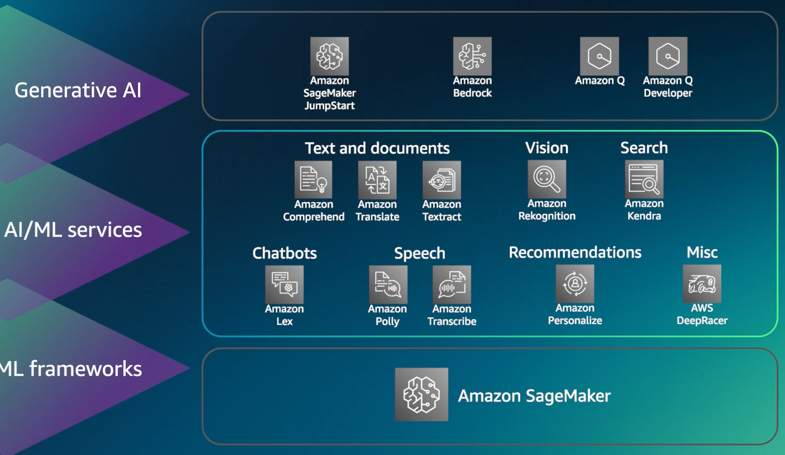

# Task 2.3: Describe AWS infrastructure and technologies for building GenAI applications

## Exam focus

Domain 2 accounts for **24% of scored exam content**. Task 2.3 tests whether you can select the AWS product that fits a GenAI scenario and reason about managed-service benefits, security duties, deployment constraints, and cost tradeoffs.

This lesson covers every Task 2.3 objective in the [current AWS Domain 2 outline](https://docs.aws.amazon.com/aws-certification/latest/ai-practitioner-01/ai-practitioner-01-domain2.html).

## Mental model: consume, build, assist, develop, or operate agents

Place the workload into one lane:

- **Consume foundation models through a managed API:** Amazon Bedrock.
- **Build, tune, and host ML models with infrastructure control:** Amazon SageMaker AI, with SageMaker JumpStart for pretrained starting points.
- **Give business users an AI workspace:** Amazon Quick.
- **Give software developers an agentic development environment:** Kiro.
- **Write an agent in code:** Strands Agents.
- **Deploy and operate agents at scale:** Amazon Bedrock AgentCore.

These products can work together. Strands can define agent behavior, Bedrock can provide the model, and AgentCore can operate the agent.

## Service-selection guide

| Service or feature | Select it for | Do not confuse it with |
|---|---|---|
| Amazon Bedrock | Managed access to foundation models and GenAI application capabilities | Training arbitrary models from scratch with chosen infrastructure |
| Amazon SageMaker AI | Build, train, tune, deploy, and manage custom ML models with control over jobs and endpoints | A serverless multi-provider FM API |
| SageMaker JumpStart | Discover, customize, and deploy pretrained models and solutions through SageMaker AI | Bedrock's managed model API |
| Amazon Quick | AI-powered workspace for business users: chat, research, analytics, autonomous agents, flows, and natural-language application building across connected enterprise data and applications | A model-training platform |
| Kiro | AI coding agent available through an agentic desktop environment, CLI, and other surfaces, with spec-driven development, built-in and custom agents, steering, and event-driven hooks | A production agent-hosting service |
| Strands Agents | Open-source, model-driven SDK for agents with tools, memory, MCP support, and multi-agent graph, swarm, and workflow patterns | Managed infrastructure that operates the agent |
| Amazon Bedrock AgentCore | Composable managed capabilities for agent loops, runtime, tools, identity, memory, policy, observability, evaluation, optimization, payments, and governed discovery | The model itself or only an agent-development SDK |

### Visual: different levels of managed AI

The layers below show a useful choice: consume an AI capability, build an application around foundation models, or manage more of the model-development workflow. For example, a team can extract receipt text with Textract, summarize that text with a model through Bedrock, or use SageMaker AI when it needs to train and host a custom model. One application can combine several layers.

*Source: 2024 personal study notes, PDF p. 24. This is a historical service map, not a current availability list. It contains older Amazon Q branding and services such as Kendra and DeepRacer whose availability has changed. Use the service-selection table above and the linked current AWS documentation for today's product names and choices. The layers describe roles rather than strict boundaries between services.*

### Amazon Bedrock

Amazon Bedrock provides managed access to models from Amazon and other providers. Application teams can invoke supported message models through a common interface such as the Converse API. Model capability and regional availability vary, so verify the [supported-model table](https://docs.aws.amazon.com/bedrock/latest/userguide/models-supported.html).

Recognize these Bedrock application capabilities:

- **Knowledge Bases** retrieves relevant organization data for retrieval-augmented generation.
- **Guardrails** applies configurable checks to model inputs and responses.
- **Model evaluation** compares model or application quality with automated or human methods.
- **Model customization** adapts supported models when prompting or retrieval does not meet the need.

Amazon Bedrock Agents, launched in November 2023, is now named **Amazon Bedrock Agents Classic**. AWS moved it to maintenance on July 30, 2026: existing customers can continue to use it, but new customers cannot access it. Earlier materials and existing architectures still use it. For new agent workloads, evaluate AgentCore Harness or other AgentCore capabilities.

### SageMaker AI and JumpStart

Choose SageMaker AI when data scientists and ML engineers need control over preparation, training jobs, algorithms or containers, tuning, endpoints, and MLOps.

SageMaker JumpStart provides pretrained models and solutions inside the SageMaker environment. It shortens model discovery and deployment while preserving SageMaker endpoint and infrastructure choices. Check each model's license and deployment terms.

A useful exam distinction:

- Bedrock: invoke managed FMs and use managed GenAI building blocks.
- SageMaker AI: own the model-development and hosting workflow.
- JumpStart: start that SageMaker workflow from a pretrained model.

### Worked example: model access versus model development

*The decision describes a starting point based on required control; the platforms have overlapping capabilities.*

Two teams want AI capabilities but need different control. Team A already has support notes and wants an existing foundation model to summarize them through a managed **API**, an interface an application calls. **Amazon Bedrock** fits that starting point because the requirement centers on invoking managed foundation models and using generative-AI features.

Team B needs to run its own training algorithm, choose training resources, and deploy the resulting model to an endpoint. **Amazon SageMaker AI** fits that model-development and hosting workflow. An endpoint is an address where an application sends inference requests. If Team B can begin with a pretrained model instead, **SageMaker JumpStart** can shorten discovery and deployment within the same SageMaker environment. JumpStart does not turn that workflow into Bedrock’s managed model API. The key difference is the requested control, rather than simply whether both projects involve AI.

### Amazon Quick

Amazon Quick is an AI-powered workspace for business users. It combines conversational assistance, source-traced research, analytics across connected datasets, flows for reusable automation, autonomous agents with configurable autonomy, and natural-language application building. Quick respects connected identity and authorization controls. Choose it for employee-facing analysis and work rather than custom model training.

### Kiro

Kiro is an AI coding agent available through an agentic desktop development environment, a command-line interface, and other surfaces. It supports spec-driven development, built-in and custom agents, persistent steering, and event-driven hooks. Kiro can generate and run tests; its Specs correctness feature adds optional property-based testing in the IDE. Choose Kiro for software-development work, not as the runtime for a customer-facing production agent.

### Strands Agents and AgentCore

Strands Agents is an open-source, model-driven SDK. Developers connect a model, instructions, tools, and memory, then use its agent loop or multi-agent patterns such as graphs, swarms, and workflows. Strands can connect to MCP servers and run in several environments; it does not supply managed production infrastructure by itself.

Amazon Bedrock AgentCore is a composable platform for building, connecting, operating, evaluating, and improving agents with different models and frameworks. Current capabilities include:

- **Harness:** managed agent loop configured with a model, system prompt, and tools; it handles orchestration, tool execution, state, and isolated sessions.
- **Runtime:** serverless, isolated hosting for custom agent and tool workloads.
- **Gateway:** converts APIs and Lambda functions into agent-compatible tools and connects existing MCP servers.
- **Identity, Memory, and Policy:** authenticate agents and users, broker credentials, retain short- and long-term context, and enforce tool-call boundaries.
- **Observability and Evaluations:** collect standardized telemetry and score agent quality online or on demand. Instrumentation and sampling determine which activity appears; do not assume every internal model step is recorded.
- **Browser and Code Interpreter:** managed web interaction and isolated code execution.
- **Registry:** governed discovery and reuse of agents, tools, MCP servers, and skills.
- **Payments:** payment orchestration for paid APIs, MCP servers, agents, and content, with third-party wallets, spending controls, x402 or supported payment protocols, and transaction observability.
- **Optimization:** analyzes production traces for failure, intent, and trajectory insights, proposes improvements, and validates candidates with batch evaluation or A/B tests before approval.

Choose the smallest set of AgentCore capabilities that the workload needs. Availability, preview status, Regions, and pricing can differ by capability.

### Worked example: tracing an order-status agent

*This is one possible custom-agent architecture. The framework, model service, runtime, and tool authorization perform different jobs.*

A user asks an agent to **“Track order 4821.”** A developer uses **Strands Agents**, a software development kit, to define the loop that exchanges information with a model, chooses tools, and observes results. In this example, **AgentCore Runtime** hosts that custom agent code. The loop calls an **Amazon Bedrock model API** separately; Runtime is not hosting the foundation model itself.

The model proposes `get_order(4821)`. Before execution, the application validates the argument and checks that the caller may read this order. The order API returns **“in transit,”** which becomes context for the agent’s response. Read permission does not authorize cancellation or deletion. A framework alone does not provide this authorization or production hosting. As a different implementation choice, **AgentCore Harness** can supply a managed agent loop. These components are roles in a design, not interchangeable names for one service.

## Advantages of AWS GenAI services

- **Accessibility and lower entry barrier:** managed services remove much of the work of procuring accelerators and running model servers.
- **Efficiency:** teams can use APIs, managed deployment, monitoring, and security integrations instead of building every layer.
- **Cost choices:** teams can match model size, serving tier, batch mode, and customization to workload economics.
- **Speed to market:** pretrained models and managed features shorten the route from experiment to controlled application.
- **Business alignment:** teams can choose a narrow service or combine services instead of forcing one platform onto every problem.

Managed does not mean responsibility-free. Customers still choose models, configure identity and network controls, test outputs, protect data, monitor cost, and set human-approval boundaries.

## Security, compliance, responsibility, and safety

AWS applies the shared responsibility model. AWS secures the infrastructure that runs AWS services. Customers secure and govern their data, identities, configurations, application logic, and use cases.

Common controls include:

- IAM roles and least-privilege permissions;
- encryption in transit and at rest, with AWS KMS options where supported;
- private connectivity and network controls where the architecture requires them;
- AWS CloudTrail and Amazon CloudWatch for audit and observability;
- Bedrock Guardrails for configurable content and sensitive-information controls;
- evaluation datasets, red-team testing, and human review for relevant risks;
- region selection for residency, latency, service availability, and compliance needs.

Guardrails do not replace authorization or factual validation. An agent-generated tool parameter is untrusted input and must pass application checks before the tool acts.

## Cost and architecture tradeoffs

### Capacity and pricing choices

| Choice | Fit | Tradeoff |
|---|---|---|
| On-demand token pricing | New, variable, or uncertain text workloads | No capacity commitment; unit cost and available throughput depend on model and tier |
| Batch inference | Bulk work without an interactive deadline | Lower urgency and different pricing; results arrive after processing |
| Provisioned Throughput | Dedicated model units for predictable sustained demand or supported custom-model use | Bedrock bills model units hourly whether used or not. Omit `commitmentDuration` for no commitment. `OneMonth` and `SixMonths` are the API commitment values. Custom models support all three levels; base-model support varies, so check the current supported-model table |
| Reserved service tier | Mission-critical steady workloads that need reserved capacity | Term commitment and planning burden |
| Priority tier | Latency-sensitive workloads that need premium service | Higher price |
| Standard tier | General on-demand use | Default balance |
| Flex tier | Cost-sensitive work that can tolerate queueing | Lower priority and higher latency variance |

AWS changes model prices and available modes. Compare current rates on the [Amazon Bedrock pricing page](https://aws.amazon.com/bedrock/pricing/) and test realistic token volumes.

### Other tradeoffs

- **Responsiveness:** faster models and premium capacity may cost more.
- **Availability and redundancy:** multi-Region architecture can add transfer, replication, and residency costs. Bedrock cross-Region inference itself adds no routing or data-transfer charge; model token pricing follows the source Region. Global profiles can have different token prices from geographic profiles.
- **Performance:** model parameter count can correlate with capability and compute demand, but it does not directly determine the number of input or output tokens in a request. Token charges follow tokenized input and generated output, while model choice sets the rate and influences latency, throughput, and quality. Benchmark the actual workload.
- **Regional coverage:** a model or feature may not exist in the preferred Region. A closer Region can reduce network latency.
- **Token pricing:** long prompts, repeated history, retrieved passages, and long outputs raise input or output charges.
- **Custom models:** customization adds training, evaluation, storage, and deployment cost. Use prompting or retrieval when they meet the requirement.
- **Self-hosting:** dedicated endpoints can make sense for control or steady utilization, but the team owns scaling and operations.

Cross-Region inference can distribute Bedrock traffic. Geographic profiles constrain routing to a geography; global profiles allow broader routing. Treat that choice as both an availability and data-residency decision.

## Scenario practice

### Scenario 1: multi-provider FM experiment

A team wants to compare supported text models through one managed AWS service without running GPU instances.

**Answer: Amazon Bedrock.** It provides managed model access. SageMaker AI fits teams that need more control over training and hosting infrastructure.

### Scenario 2: custom training container

Data scientists need a custom algorithm, chosen instance types, training jobs, and a managed real-time endpoint.

**Answer: Amazon SageMaker AI.** The requirement centers on model development and infrastructure choices.

### Scenario 3: pretrained model under SageMaker control

A team wants a pretrained open model but must deploy it to a SageMaker AI endpoint it controls.

**Answer: SageMaker JumpStart.** JumpStart shortens discovery and setup while the endpoint remains in the SageMaker workflow.

### Scenario 4: employee business analysis

Finance users want to ask questions about connected business data and automate recurring research without building an ML platform.

**Answer: Amazon Quick.** The audience and task are business work through natural language.

### Scenario 5: coded agent versus production operation

Developers need an open-source SDK to define an agent today and a managed AWS service to operate it in production.

**Answer: Strands Agents for implementation and Amazon Bedrock AgentCore for managed operation.** The SDK and platform solve different layers.

### Scenario 6: steady high-volume inference

A production workload has predictable sustained model demand and needs stable reserved capacity.

**Answer: evaluate Provisioned Throughput or the current reserved capacity option against measured demand.** On-demand is easier to start, but reserved capacity may fit predictable utilization. A commitment loses value if demand stays low.

## Common confusions and traps

- Bedrock and SageMaker AI overlap, but they optimize for different control levels. Bedrock starts with managed FMs; SageMaker AI starts with the ML build-and-host workflow.
- JumpStart is part of SageMaker AI. It is not a separate serverless alternative to Bedrock.
- Amazon Quick targets business work. Kiro targets software development.
- Strands Agents is an SDK. AgentCore is a managed platform for production agents.
- AgentCore is not a foundation model. It can work with different frameworks and models.
- Guardrails support safety controls. They do not replace IAM, source authorization, output validation, or human review.
- Region support varies by model and feature. Never assume a named model is available in every Region.
- On-demand, provisioned capacity, and service tiers express cost and performance choices. The lowest unit price may not meet latency or availability needs.
- Customization is not free after training. It adds evaluation, hosting, monitoring, and update work.

## Compact decision table

| Requirement | Select |
|---|---|
| Managed FM API | Amazon Bedrock |
| Train and host a custom model | Amazon SageMaker AI |
| Start from a pretrained model in SageMaker | SageMaker JumpStart |
| Business-user AI workspace | Amazon Quick |
| Agentic software-development environment | Kiro |
| Code an agent with an open-source SDK | Strands Agents |
| Deploy and operate agents on a managed platform | Amazon Bedrock AgentCore |
| Variable early-stage model traffic | On-demand |
| Bulk noninteractive model jobs | Batch inference |
| Predictable sustained demand | Evaluate provisioned or reserved capacity |

## Self-check

1. **Which service fits managed access to several foundation-model providers?**

   Amazon Bedrock.

2. **Which option fits a pretrained model that must run on a team-controlled SageMaker endpoint?**

   SageMaker JumpStart within Amazon SageMaker AI.

3. **How do Strands Agents and AgentCore differ?**

   Strands Agents is an SDK for implementing agent behavior. AgentCore is a managed platform for deploying and operating agents.

4. **Does Bedrock Guardrails replace IAM?**

   No. Guardrails checks content; IAM controls access to AWS actions and resources.

5. **Which pricing approach fits an experimental workload with uncertain traffic?**

   Start with on-demand and measure usage before making a capacity commitment.

## Practice links

- [Domain 2 questions with answers and explanations](../../practice/question-bank.md#task-23)

## Official sources

- [AWS Certified AI Practitioner Domain 2 objectives](https://docs.aws.amazon.com/aws-certification/latest/ai-practitioner-01/ai-practitioner-01-domain2.html)
- [Amazon Bedrock User Guide](https://docs.aws.amazon.com/bedrock/latest/userguide/what-is-bedrock.html)
- [Amazon Bedrock supported models](https://docs.aws.amazon.com/bedrock/latest/userguide/models-supported.html)
- [Amazon Bedrock service tiers](https://docs.aws.amazon.com/bedrock/latest/userguide/service-tiers-inference.html)
- [Amazon Bedrock pricing](https://aws.amazon.com/bedrock/pricing/)
- [Amazon SageMaker JumpStart foundation models](https://docs.aws.amazon.com/sagemaker/latest/dg/jumpstart-foundation-models.html)
- [Amazon Quick User Guide](https://docs.aws.amazon.com/quicksuite/latest/userguide/)
- [Kiro documentation](https://kiro.dev/docs/)
- [How Kiro works](https://kiro.dev/docs/how-kiro-works.md)
- [Strands Agents documentation](https://strandsagents.com/latest/documentation/docs/user-guide/quickstart/)
- [Amazon Bedrock AgentCore User Guide](https://docs.aws.amazon.com/bedrock-agentcore/latest/devguide/)
- [AgentCore Harness](https://aws.amazon.com/about-aws/whats-new/2026/06/amazon-bedrock-agentcore-harness-generally-available/)
- [AgentCore Payments](https://aws.amazon.com/about-aws/whats-new/2026/08/bedrock-agentcore-payments-ga/)
- [AgentCore Optimization](https://aws.amazon.com/about-aws/whats-new/2026/06/amazon-bedrock-agentcore-new-optimization-capabilities/)
- [Amazon Bedrock Agents Classic maintenance mode](https://docs.aws.amazon.com/bedrock/latest/userguide/agents-classic-maintenance-mode.html)
- [Amazon Bedrock security](https://docs.aws.amazon.com/bedrock/latest/userguide/security.html)

Source descriptions in this lesson were rephrased for compliance with licensing restrictions.

---

[Domain contents](README.md) · [All domains and objectives](../../README.md#domain-guide)

**Previous:** [Lesson 05](05-genai-value-limitations.md) · **Next:** [Lesson 07](../domain-3-foundation-models/07-fm-design-rag-agents.md)
