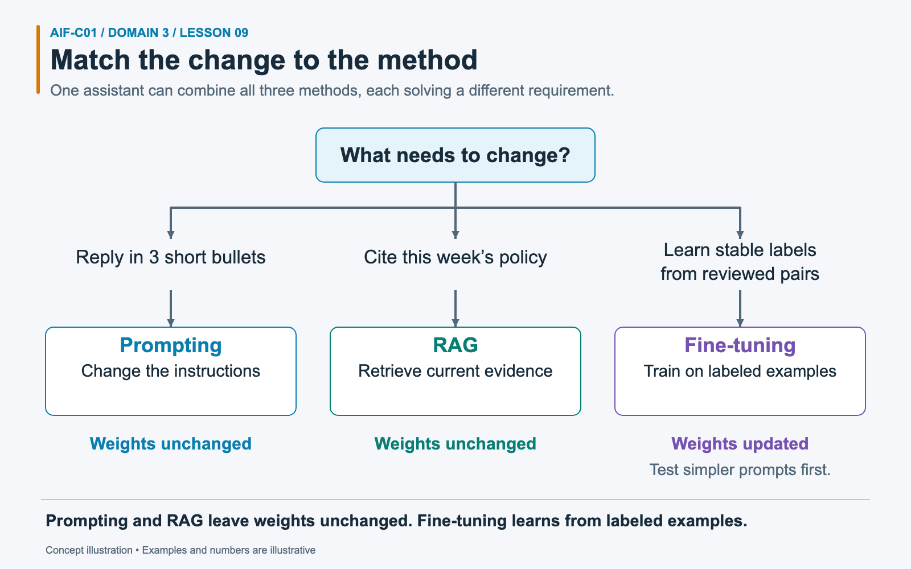
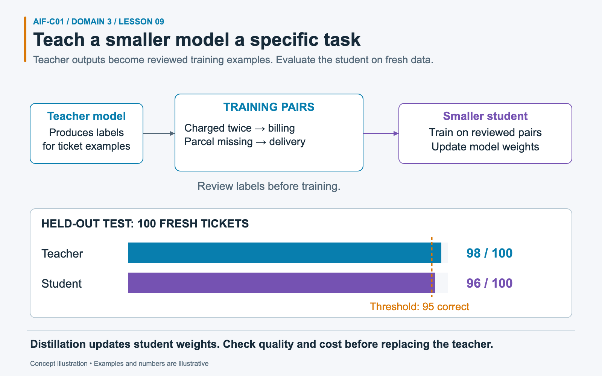
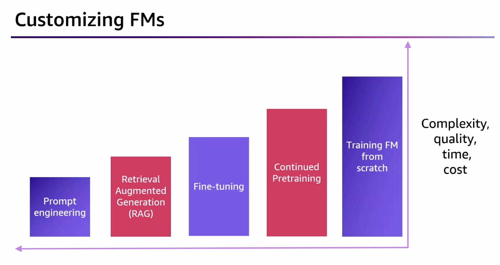

# Task 3.3: Describe the training and fine-tuning process for FMs

Foundation model development spans several kinds of training. AIF-C01 tests whether you can match the data and business goal to pre-training, continued pre-training, fine-tuning, distillation, transfer learning, instruction tuning, or reinforcement learning from human feedback (RLHF).

## Exam focus

Most questions name the available data and the desired change. Look for these signals:

- massive general corpus and a model built from scratch: **pre-training**;
- large unlabeled industry corpus and an existing model: **continued pre-training**;
- labeled input-output examples and a stable task: **fine-tuning**;
- instructions across many tasks: **instruction tuning**;
- human rankings of candidate responses: **RLHF**;
- a large teacher and cheaper student: **distillation**;
- current documents that change often: **RAG**, not training.

You should also understand data curation, labeling, size, representativeness, governance, and the cost of each choice.

## Mental model: knowledge, behavior, preference, and efficiency

Each customization method changes a different part of the problem:

- **Pre-training** creates broad capability.
- **Continued pre-training** extends domain language and knowledge.
- **Fine-tuning** teaches a stable input-to-output behavior.
- **RLHF** aligns responses with human preferences.
- **Distillation** transfers useful behavior to a smaller model.
- **RAG** supplies facts at request time and leaves weights unchanged.

Start by asking what must change. New facts, task behavior, human preference, and inference economics call for different methods.

## Training methods compared

| Method | Starting point | Typical data | Changes weights? | Main goal | Relative cost |
| --- | --- | --- | --- | --- | --- |
| Pre-training | Random or untrained model | Vast, broad, mostly unlabeled corpus | Yes | Create a general foundation model | Highest |
| Continued pre-training | Existing pre-trained FM | Large unlabeled domain corpus | Yes | Improve domain language and concepts | High |
| Supervised fine-tuning | Existing FM | Curated labeled prompt-response pairs | Yes | Improve a task, style, or output format | Moderate to high |
| Instruction tuning | Existing FM | Many instructions paired with desired responses | Yes | Improve instruction following across tasks | Moderate to high |
| RLHF | Instruction-tuned or fine-tuned model | Human preference rankings or feedback | Yes | Align output with human judgments | High and operationally complex |
| Distillation | Teacher and student models | Teacher responses, prompts, and optional labels | Yes, student weights | Lower inference cost and latency | Training cost, lower run cost |
| RAG | Existing FM | Indexed documents and request-time retrieval | No | Add current, private, or cited facts | Low to moderate |
| In-context learning | Existing FM | Examples in each prompt | No | Guide one request without training | Low upfront; repeated token cost |

The relative costs are exam-level comparisons, not price quotes. Model support, dataset size, training duration, hosting, throughput, and region affect the bill.

### Worked example: three requests from one support team



*Choose the method from the requirement and available data, then evaluate the result.*

A shop wants three improvements to its assistant. First, replies should contain three short bullets. That is a change to instructions, so test a clearer **prompt**, the request sent to the model. Second, answers must cite a refund policy that changes weekly. Use **RAG**, which retrieves current evidence and supplies it with the request. Third, the assistant must reliably assign stable support labels such as `damaged_item`; the team has reviewed input-output pairs, including “Broken handle” → `damaged_item`.

For the third need, test prompt and few-shot baselines first. If measured performance remains insufficient, consider supervised **fine-tuning**, training an existing model on labeled examples. This changes model weights, the learned numerical parameters.

Prompting and RAG leave weights unchanged. Fine-tuning does not keep changing policies automatically current. A production assistant can combine these methods, with separate tests for format, factual grounding, and classification behavior.

## Pre-training builds the base model

Pre-training exposes a model to a vast corpus and trains it to predict missing or next tokens. The data supplies training signals without people labeling every sentence. The process builds language patterns, broad knowledge, and general capabilities.

Model providers perform most FM pre-training because it requires large datasets, distributed compute, specialist teams, and extensive evaluation. A business should not choose pre-training from scratch when prompt engineering, RAG, or customization of an existing FM meets the need.

### Exam cues

Choose pre-training when the scenario says:

- build a new foundation model from the ground up;
- use a vast general corpus;
- create base capabilities rather than adapt an existing model;
- accept the greatest compute, data, time, and cost burden.

## Continued pre-training deepens domain capability

Continued pre-training, also called continuous pre-training in some exam material, starts with a pre-trained model and trains it on more unlabeled text. It fits domains with specialized vocabulary, concepts, and writing patterns.

A pharmaceutical corpus, legal archive, or engineering document collection may improve the model's command of domain language. This method costs more than prompt engineering or RAG because it updates weights and needs substantial training data and compute.

Continued pre-training is not the best answer for documents that change each week and must support citations. RAG handles that requirement with less retraining.

## Fine-tuning teaches stable behavior

Supervised fine-tuning trains an existing model on examples of the desired mapping from input to output.

Example record:

```json
{
  "prompt": "Customer: My package arrived with a broken handle.",
  "completion": "{\"category\":\"damaged_item\",\"priority\":\"normal\"}"
}
```

Dataset formats differ by model and customization method. The exam cares about the concept: labeled examples pair an input with the expected response.

Fine-tuning fits:

- stable classification labels;
- a consistent brand voice;
- a fixed output format;
- task-specific response patterns;
- behavior that few-shot prompts do not produce with enough reliability.

Fine-tuning is a poor knowledge store for frequently changing facts. The model may memorize stale material, omit sources, or need another training run after each update.

### Instruction tuning

Instruction tuning uses collections of instructions and good responses. It teaches the model to follow varied requests, not only one narrow classifier. Data quality depends on clear instructions, correct outputs, and coverage across task types.

### Domain adaptation

Domain adaptation specializes a model for a field. Continued pre-training often supports domain adaptation with unlabeled text. Supervised fine-tuning can then teach a specific domain task with labeled examples.

### Transfer learning

Transfer learning reuses patterns learned during pre-training. Fine-tuning needs less data and compute than training from scratch because the model already has broad language capability. Transfer learning is the general principle behind adapting a pre-trained model to a new task.

## RLHF and Bedrock reinforcement fine-tuning use different feedback sources

**RLHF** is the general alignment method named in the exam objective. A common RLHF process uses human judgments:

1. Reviewers compare or rank several responses to the same prompt.
2. The training process turns those preferences into a reward signal or reward model.
3. Reinforcement learning updates the FM to favor responses that earn higher rewards.
4. Evaluators check quality, safety, and regressions on held-out data.

The exam cue for RLHF is **people rank responses**. Labeled prompt-completion pairs point to supervised fine-tuning. Unlabeled domain text points to continued pre-training.

**Amazon Bedrock reinforcement fine-tuning (RFT)** is a current Bedrock customization feature for supported models. Bedrock generates several responses for each training prompt, scores them with a configured reward function, and uses those scores for policy-based learning. The reward can come from programmatic verification or a model judge; it is not necessarily human feedback and should not be labeled RLHF unless people supply the preference signal.

Human feedback can contain disagreement and bias. Programmatic graders and model judges can encode mistakes or reward shortcuts. Test the reward design and the resulting model on held-out data.

## Distillation creates a smaller student

Distillation uses a capable teacher model to produce responses or learning signals for a smaller student. The student learns the target task and can reduce latency and inference cost.

| Distillation benefit | Tradeoff |
| --- | --- |
| Smaller model and lower per-request cost | Upfront teacher inference and training cost |
| Faster responses | Student may lose broad capability |
| Higher throughput for a narrow task | Quality depends on prompts and teacher outputs |
| Deployment of task-specific behavior | Requires evaluation against the teacher and business target |

Distillation differs from compression through file formats or token trimming. It is a training process. The student changes its weights.

Use a break-even view: estimate training cost, expected request volume, per-request savings, quality change, and model-lifecycle cost. A low-volume workload may never recover the customization expense.

### Worked example: teach a smaller ticket classifier



*Illustrative evaluation counts, not a model benchmark. The student must be tested on unseen examples.*

A support team uses a capable but costly model to classify tickets. It wants a smaller model for the same narrow task. In **distillation**, the larger **teacher** produces learning examples and a smaller **student** trains on them. Example pairs might be “Charged twice” → `billing` and “Parcel missing” → `delivery`. Review the teacher’s outputs before training because a teacher can be wrong.

After training, evaluate on 100 **held-out** tickets: examples excluded from training and development choices. In this illustrative result, the teacher gets 98 correct and the student gets 96. The team’s quality threshold was 95, so the student passes this test; it must also meet the team’s safety and cost requirements.

Distillation changes the student’s weights. It is not shortening a prompt or compressing a model file. Training adds upfront expense, so compare expected operating savings and request volume before deciding whether it is worthwhile.

## Prepare training data

Model quality cannot exceed the quality of the examples and feedback used for training.

### Data curation

Curation selects and cleans data. Remove duplicates, corrupt records, contradictions, irrelevant samples, leaked evaluation items, and content you lack the right to use. Keep hard examples that reflect production rather than polishing the dataset until it becomes unrealistic.

### Data size

More data can help only when it adds useful coverage. A small set of accurate, diverse examples can beat a large set of noisy duplicates. Follow the chosen model's current minimum and maximum dataset requirements.

### Labeling

Labels must match the task definition. Write annotation guidance, train reviewers, measure agreement, and resolve ambiguous cases. If labels conflict, the model receives conflicting signals.

### Representativeness

Training data should cover the users, languages, document types, input lengths, rare cases, and failure conditions the application will face. A dataset of short English requests does not represent a multilingual workload with long documents.

### Governance

Governance tracks where data came from, who may use it, how long it may be retained, and which transformations occurred. It should cover:

- ownership, licenses, and consent;
- personal, confidential, or regulated information;
- access control and encryption;
- provenance and lineage;
- retention and deletion;
- dataset and model versions;
- review and approval records.

### Split the data

Use separate training, validation, and test sets. Training examples update the model. Validation data guides choices during development. A held-out test set estimates performance after choices are complete. Deduplicate across splits to prevent leakage.

| Data problem | Result |
| --- | --- |
| Duplicate records across train and test | Inflated test score |
| Inconsistent labels | Unstable behavior |
| Missing minority cases | Uneven performance and bias |
| Production data appears in training without permission | Privacy and compliance risk |
| Only easy examples | Weak edge-case performance |
| Stale examples | Model learns obsolete behavior |

## Choose customization by requirement

| Requirement | First choice | Why |
| --- | --- | --- |
| Change tone or response format with little effort | Prompt engineering | No training job |
| Add changing private facts and citations | RAG | Refreshes sources without weight updates |
| Teach stable labels or response behavior | Fine-tuning | Labeled examples update behavior |
| Teach specialized vocabulary from a large corpus | Continued pre-training | Uses unlabeled domain text |
| Align answers with ranked human preferences | RLHF | Uses preference feedback |
| Reduce recurring inference cost for a narrow, high-volume task | Distillation | Moves teacher behavior to a smaller model |
| Create a new general FM | Pre-training | Builds base capability from scratch |

A combined design may use continued pre-training for domain language, fine-tuning for task behavior, RAG for current facts, and prompt engineering for each request.

## Cost and lifecycle tradeoffs

| Cost area | Prompt / in-context | RAG | Fine-tuning | Continued pre-training | Distillation | Pre-training |
| --- | --- | --- | --- | --- | --- | --- |
| Data preparation | Low | Moderate | High | High | High | Very high |
| Training compute | None | None | Moderate to high | High | Moderate to high | Very high |
| Request tokens | Examples repeat | Retrieved chunks repeat | May use shorter prompts | May use shorter prompts | Lower with student | Depends on model size |
| Infrastructure | Prompt store | Ingestion and vector store | Custom model lifecycle | Custom model lifecycle | Teacher and student lifecycle | Full training stack |
| Update process | Edit prompt | Re-ingest data | Train again | Train again | Distill again when task shifts | Train new model versions |
| Best economic fit | Fast experiments | Changing knowledge | Stable behavior at enough volume | Deep domain need | High-volume narrow task | Model provider scale |

Do not assume that training saves money. Include data labeling, experimentation, failed jobs, evaluation, deployment, monitoring, and future retraining.



*Source: 2024 personal study notes, PDF p. 107. Read the bars as a rough illustration of potential complexity, time, and cost—not measured values or a guaranteed ordering. Although the original axis includes “quality,” more training does not guarantee a better result. Distillation is omitted from this historical figure and is included in the comparison table above.*

For a café whose opening hours change frequently, retrieving the current hours with RAG may produce a more useful answer than training a model from scratch. Choose the method that addresses the actual problem, then measure quality, safety, latency, and total cost.

## Scenario practice with reasoning

### Scenario 1: New legal vocabulary

A legal research company has millions of unlabeled documents. Its model struggles to interpret specialist terms before it even reaches the answer task.

**Best choice:** Continue pre-training an existing model on the curated legal corpus, then fine-tune for any labeled downstream task if needed.

**Reasoning:** The company has abundant unlabeled domain text and needs stronger domain understanding. RAG can retrieve passages but may not fix weak interpretation of the vocabulary.

### Scenario 2: Four support labels

A support team needs the same four ticket categories and has 20,000 reviewed ticket-label pairs.

**Best choice:** Use supervised fine-tuning after testing prompt and few-shot baselines.

**Reasoning:** The requirement is stable behavior and the company has labeled examples. Continued pre-training would use the wrong data form and cost more.

### Scenario 3: Policies change each month

An insurer needs answers from policy documents that change each month and must show the source section.

**Best choice:** Use RAG, not fine-tuning.

**Reasoning:** Retrieval can refresh knowledge and return citations. Training would capture a stale snapshot and require repeated jobs.

### Scenario 4: Humans rank tone

A writing assistant produces several replies for each prompt. Reviewers rank the replies by helpfulness, safety, and tone.

**Best choice:** Use the rankings in an RLHF-style alignment process.

**Reasoning:** Preference rankings are the defining data signal. Prompt-completion pairs would indicate supervised fine-tuning instead.

### Scenario 5: Teacher cost at scale

A strong model handles fraud-case routing, but its price and latency do not fit a projected volume of 50 million requests.

**Best choice:** Distill its task behavior into a smaller student and evaluate the student on rare fraud cases.

**Reasoning:** The goal is lower recurring inference cost for a narrow task. The rare cases protect against accepting a cheap student that fails where losses are largest.

### Scenario 6: Build a new base model

A research lab has a vast licensed corpus, a distributed training cluster, and a goal to create a new general-purpose language model.

**Best choice:** Pre-train from scratch.

**Reasoning:** The lab wants new base capability and has the resources that pre-training requires. This is uncommon for a normal business application.

### Scenario 7: Dataset looks accurate but fails for users

A fine-tuned assistant scores well on its test set but performs poorly on long Spanish requests. The training and test data contain short English prompts.

**Best choice:** Rebuild representative datasets that include target languages and input lengths, then retrain and reevaluate by subgroup.

**Reasoning:** The test set measured the same narrow distribution as training. More English duplicates would not cover the missing production cases.

## Common exam traps

- **Pre-training and continued pre-training are the same:** Continued pre-training starts from an existing model.
- **Fine-tuning uses unlabeled domain documents:** Supervised fine-tuning uses labeled examples; continued pre-training uses a large unlabeled corpus.
- **RLHF means reviewers write every response:** The key signal is human preference or feedback used for reinforcement learning.
- **Transfer learning is a competing dataset format:** It is the reuse of learned capability from a pre-trained model.
- **Distillation retrieves teacher answers at runtime:** Distillation trains a student before inference.
- **RAG updates weights:** It adds retrieved text to the request.
- **More data fixes label errors:** Larger noisy datasets can reinforce the errors.
- **A random split prevents leakage:** Near-duplicates can still appear across splits.
- **Fine-tuning is cheaper than prompting by default:** It adds training and lifecycle costs that need enough stable volume to justify them.
- **Custom models remove evaluation needs:** Every training method can create regressions and requires held-out tests.

## Self-check

### 1. Which method uses a large unlabeled medical corpus to improve an existing model's domain language?

**Answer:** Continued pre-training. It extends a pre-trained model with more unlabeled domain text.

### 2. Which dataset fits supervised fine-tuning?

**Answer:** Curated labeled input-output pairs, such as a customer ticket and its approved category or response.

### 3. Reviewers rank four responses to each prompt. Which method does this support?

**Answer:** RLHF or another preference-based alignment method. Human rankings supply the reward signal.

### 4. Why can distillation lower total cost?

**Answer:** A smaller student can handle a high-volume task with lower latency and inference cost. The workload must save enough to recover teacher generation, training, evaluation, and deployment costs.

### 5. Which data property is missing if a global chatbot trains only on short English requests?

**Answer:** Representativeness. The dataset does not cover the target languages or long-input cases found in production.

## Practice

- [Domain 3 question bank](../../practice/question-bank.md#task-33)

## Official sources

- [Official AIF-C01 Domain 3 objectives](https://docs.aws.amazon.com/aws-certification/latest/ai-practitioner-01/ai-practitioner-01-domain3.html)
- [Amazon Bedrock model customization](https://docs.aws.amazon.com/bedrock/latest/userguide/custom-models.html)
- [Fine-tune a model in Amazon Bedrock](https://docs.aws.amazon.com/bedrock/latest/userguide/custom-model-fine-tuning.html)
- [Model distillation in Amazon Bedrock](https://docs.aws.amazon.com/bedrock/latest/userguide/model-distillation.html)
- [Prepare distillation datasets](https://docs.aws.amazon.com/bedrock/latest/userguide/distillation-prepare-datasets.html)
- [Reinforcement fine-tuning in Amazon Bedrock](https://docs.aws.amazon.com/bedrock/latest/userguide/reinforcement-fine-tuning.html)
- [How Bedrock reinforcement fine-tuning works](https://docs.aws.amazon.com/bedrock/latest/userguide/reinforcement-fine-tuning.html#reinforcement-fine-tuning-how-it-works)
- [Analyze model customization results](https://docs.aws.amazon.com/bedrock/latest/userguide/model-customization-analyze.html)
- [Fine-tune foundation models in SageMaker Canvas](https://docs.aws.amazon.com/sagemaker/latest/dg/canvas-fm-chat-fine-tune.html)
- [SageMaker model customization methods](https://docs.aws.amazon.com/sagemaker/latest/dg/customize-model.html)
- [Amazon Bedrock Knowledge Bases](https://docs.aws.amazon.com/bedrock/latest/userguide/knowledge-base.html)

Content was rephrased for compliance with licensing restrictions. This lesson was written from the official AWS sources above. The local question bank informed the mix of original scenarios; no question text was copied.

---

[Domain contents](README.md) · [All domains and objectives](../../README.md#domain-guide)

**Previous:** [Lesson 08](08-prompt-engineering.md) · **Next:** [Lesson 10](10-evaluation.md)
